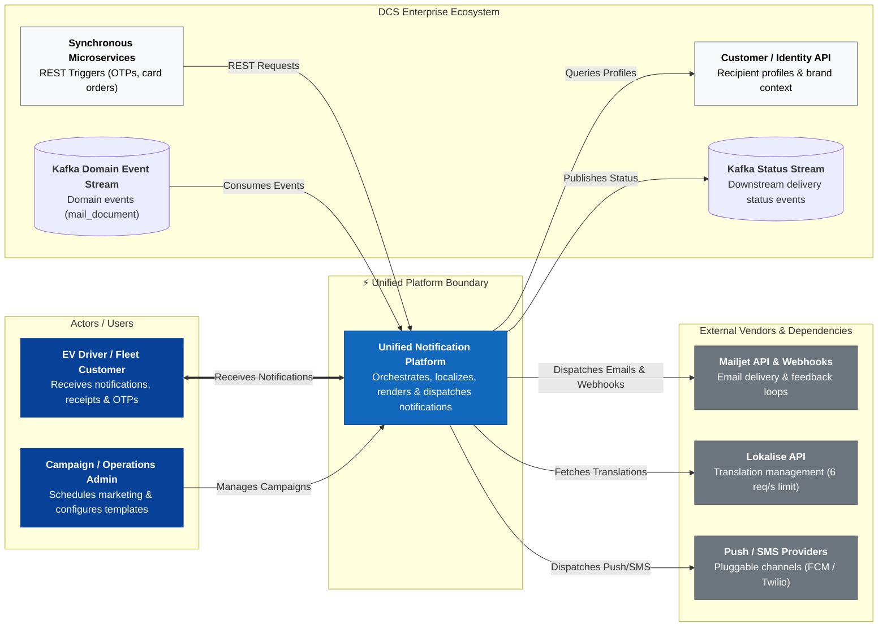

# unified-notification-platform


```mermaid
%%{init: {'theme': 'base', 'themeVariables': { 'fontSize': '16px', 'nodePadding': '12' }}}%%
sequenceDiagram
  autonumber
  actor Producer as Upstream Producer<br/>(e.g., OTP)
  participant API as Ingress + Processing<br/>& Rendering (uses Redis)
  participant Cust as Customer API
  participant DB as PostgreSQL<br/>(Messages & Outbox)
  participant Relay as Outbox Relay (Ingress svc)<br/>→ Kafka urgent topic
  participant Disp as Vendor Dispatcher
  participant Vendor as Mailjet Send v3.1 API
  participant Webhook as Webhook Receiver
  participant Recon as Status Reconciler<br/>(Webhook svc)
  participant StatusStream as Kafka Status Stream

  %% Phase 1: Ingestion & Idempotency
  rect rgb(240, 248, 255)
    note right of Producer: Phase 1: Ingestion & Idempotency Check
    Producer->>API: POST /v1/notifications (OAuth2 token, Idempotency-Key, use_case, payload)
    API->>DB: INSERT idempotency record + message under unique (producer_id, key)
    note right of API: Redis is optional cache only; PostgreSQL is authoritative
    alt Duplicate request
      API-->>Producer: HTTP 202 Accepted (same notification_id, nothing re-sent)
    end
  end

  %% Phase 2: Profile, Suppression & Rendering
  rect rgb(250, 240, 230)
    note right of API: Phase 2: Profile, Suppression & Rendering
    API->>Cust: GET /customers/{id}
    Cust-->>API: Profile (locale: 'de-DE', brand: 'OEM_A')
    API->>DB: Check suppression (blocklist / unsubscribe)
    API->>API: Read active translations from Redis, coverage check
    alt Translation missing AND legal/financial use case
      API->>DB: Store message as FAILED_CONTENT + alert operator
      API-->>Producer: HTTP 202 Accepted (notification_id, status visible via status API)
      note over API,DB: Flow stops here — not sent until content is fixed
    else Translation missing, other use case
      API->>API: Fall back to brand default language
    end
    API->>API: Render HTML (MJML / Handlebars)
  end

  %% Phase 3: Transactional Outbox & Dispatch
  rect rgb(240, 255, 240)
    note right of API: Phase 3: Outbox & Vendor Dispatch
    API->>DB: TX: insert message + ingress idempotency record + lane outbox row
    DB-->>API: COMMIT
    API-->>Producer: HTTP 202 Accepted (notification_id)
    Relay->>DB: Poll unpublished outbox rows
    Relay->>Disp: Kafka urgent topic: message
    Disp->>Disp: Take token from urgent share of rate budget
    Disp->>DB: Persist send attempt (ATTEMPTING, attempt_id, CustomID)
    Disp->>Vendor: POST /v3.1/send (payload, CustomID = notification_id)
    alt Definitive success response
      Vendor-->>Disp: HTTP 200 (Mailjet MessageID)
      Disp->>DB: Record MessageID; status = PROVIDER_ACCEPTED
    else Timeout / ambiguous response
      Disp->>DB: Mark attempt SUBMISSION_UNKNOWN
      note over Disp,DB: Reconcile using webhook/provider evidence; do not assume failure just because no event arrived
    end
  end

  %% Phase 4: Webhook Feedback & Status Reconciliation
  rect rgb(255, 245, 245)
    note right of Webhook: Phase 4: Webhook Feedback & Status Stream
    Vendor->>Webhook: POST /webhooks/mailjet (basic auth, event: sent / delivered / bounce)
    Webhook->>DB: Insert raw event idempotently (MessageID / CustomID + event identity)
    Webhook-->>Vendor: HTTP 200
    Recon->>DB: TX: correlate event, reconcile status, insert status-outbox row
    Recon->>StatusStream: Status-outbox relay publishes at-least-once
    note over Recon,StatusStream: Downstream consumers deduplicate by stable event ID
  end
```
