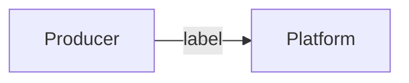
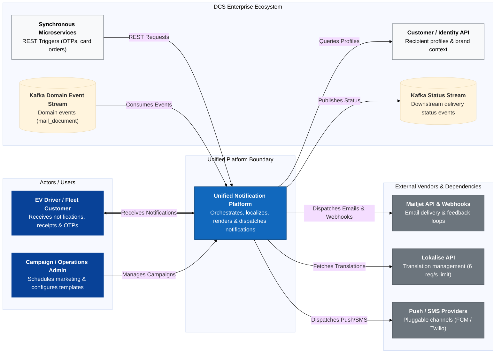

# Customer Notification Platform — Design Proposal

> 
> Read time: ~10–15 min

<!--
SKELETON — guiding questions are in HTML comments (invisible on GitHub). Delete them as you fill in.
Priority if short on time: 1 Framing → 4 Architecture → 5 Decisions.
-->

## TL;DR
<!-- 3–5 bullets: the problem in one line, the proposal in one line, the key decisions, the migration idea. Write this LAST. -->

## 1. Problem framing
<!--
- What goes wrong for customers / the business today? (consequences, not just tech smells)
- Group the issues: e.g. reliability, consistency/content drift, shared-vendor risk, compliance/data, operability, cost of change.
- Which problems are the most severe, and why?
-->

### Scope and non-goals
<!-- What the platform owns vs. what it orchestrates (Mailjet delivers, Lokalise owns translations). What's explicitly out of scope? -->

## 2. Assumptions and open questions
<!-- Number them (A1, A2...) so decisions can reference them. Volumes, peaks, latency targets, retention, channels, tenants (OEMs/Fleet), team size... -->

| # | Assumption | Why it matters |
|---|---|---|
| A1 | | |

**Open questions**
<!-- Things you'd ask product/stakeholders before building. -->

## 3. Requirements
<!-- Functional (what it must do) and non-functional (reliability, latency, throughput, compliance) — short. -->

## 4. Architecture

### 4.1 System context (C4 L1)
<!-- Producers, the platform, Mailjet, Lokalise, Customer/Identity API, Kafka, operators/people. Label every arrow. -->





### 4.2 Containers (C4 L2)
<!-- Deployables, datastores, queues/topics, and the main flows (transactional send, campaign send, status/webhooks, content sync). -->
```mermaid
%%{init: {'theme': 'base', 'themeVariables': { 'fontSize': '16px', 'nodePadding': '12' }}}%%
flowchart LR
  %% C4 Level 2: Container Architecture Diagram (GitHub Native)

  subgraph Producers ["Upstream Producers & Clients"]
    restClients["<b>Synchronous Microservices</b><br/>(OTPs, Card Orders)"]
    kafkaProducer[("<b>Kafka Event Stream</b><br/>(Billing, Dunning Events)")]
    adminUI["<b>Campaign Admin UI</b><br/>(React / TypeScript)"]
  end

  subgraph PlatformBoundary ["Unified Notification Platform"]

    subgraph IngressLayer ["1. Ingress & Trigger Layer"]
      restApi["<b>REST Ingress API</b><br/>(Quarkus / Kotlin)<br/>Low-latency sync endpoint"]
      kafkaConsumer["<b>Kafka Event Consumer</b><br/>(Quarkus / Kotlin)<br/>Asynchronous event listener"]
      campaignApi["<b>Campaign Service</b><br/>(Node / Fastify)<br/>Batching & cohort scheduling"]
    end

    subgraph ProcessingLayer ["2. Processing & Validation Engine"]
      processor["<b>Core Processing Engine</b><br/>- Idempotency & Dedup Check<br/>- Profile & Locale Resolution<br/>- Pre-Send Coverage Check"]
    end

    subgraph LocalizationLayer ["3. Localization & Template Engine"]
      templateEngine["<b>MJML/Handlebars Compiler</b><br/>Compiles HTML & brand layouts"]
      lokaliseSync["<b>Lokalise Sync Worker</b><br/>Async translation fetcher"]
    end

    subgraph QueueLayer ["4. Dual-Priority Queueing & Dispatch"]
      highPriorityQ[("<b>High-Priority Queue</b><br/>Kafka Topic / InMemory<br/>(Transactional - < 2s SLA)")]
      lowPriorityQ[("<b>Low-Priority Queue</b><br/>Redis + BullMQ<br/>(Bulk / Throttled Campaigns)")]
      dispatcher["<b>Vendor Dispatcher</b><br/>Mailjet Send v3.1 Adapter<br/>(Rate limiting & retries)"]
    end

    subgraph FeedbackLayer ["5. Status & Webhook Reconciliation"]
      webhookHandler["<b>Webhook Receiver</b><br/>Ingests Mailjet events"]
      statusPublisher["<b>Status Reconciler</b><br/>Updates DB & emits Kafka status"]
    end

    subgraph StorageLayer ["6. Storage Layer"]
      postgres[("<b>PostgreSQL DB</b><br/>Metadata, outbox, status ledger")]
      redis[("<b>Redis Datastore</b><br/>Idempotency keys, Lokalise cache, BullMQ")]
      s3Store[("<b>S3 / Azure Blob Storage</b><br/>Rendered HTML/PDF audit snapshots")]
    end

  end

  subgraph SharedServices ["External Vendors & Shared Ecosystem"]
    customerApi["<b>Customer / Identity API</b>"]
    lokaliseApi["<b>Lokalise API</b><br/>(6 req/s limit)"]
    mailjetApi["<b>Mailjet Send API & Webhooks</b>"]
    kafkaStatusStream[("<b>Kafka Status Stream</b>")]
  end

  %% Ingress Flows
  restClients -->|"1a. HTTP POST"| restApi
  kafkaProducer -->|"1b. Consume Event"| kafkaConsumer
  adminUI -->|"1c. Schedule Campaign"| campaignApi

  restApi & kafkaConsumer & campaignApi -->|"2. Process Request"| processor

  %% Processing & Storage Interactions
  processor <-->|"Idempotency & Cache"| redis
  processor -->|"Write Outbox / Ledger"| postgres
  processor -->|"Fetch Profile"| customerApi

  %% Localization Flows
  processor -->|"3. Render Template"| templateEngine
  templateEngine <-->|"Read Translation Cache"| redis
  lokaliseSync -->|"Async Sync (Bypasses Limit)"| lokaliseApi
  lokaliseSync -->|"Populate Cache"| redis

  %% Queueing & Dispatch Flows
  templateEngine -->|"4a. High-Priority"| highPriorityQ
  templateEngine -->|"4b. Low-Priority"| lowPriorityQ
  templateEngine -->|"Save Snapshot (30d)"| s3Store

  highPriorityQ & lowPriorityQ -->|"5. Pull Jobs"| dispatcher
  dispatcher -->|"6. Send Email Payload"| mailjetApi

  %% Webhook Feedback Loop
  mailjetApi -->|"7. Webhook POST"| webhookHandler
  webhookHandler -->|"8. Reconcile"| statusPublisher
  statusPublisher -->|"Update Status"| postgres
  statusPublisher -->|"Publish Event"| kafkaStatusStream

  %% Styling
  classDef producerStyle fill:#084298,stroke:#084298,color:#fff;
  classDef containerStyle fill:#1168bd,stroke:#0b4884,color:#fff;
  classDef queueStyle fill:#d97706,stroke:#b45309,color:#fff;
  classDef dbStyle fill:#15803d,stroke:#166534,color:#fff;
  classDef extStyle fill:#6c757d,stroke:#495057,color:#fff;

  class restClients,kafkaProducer,adminUI producerStyle;
  class restApi,kafkaConsumer,campaignApi,processor,templateEngine,lokaliseSync,dispatcher,webhookHandler,statusPublisher containerStyle;
  class highPriorityQ,lowPriorityQ queueStyle;
  class postgres,redis,s3Store dbStyle;
  class customerApi,lokaliseApi,mailjetApi,kafkaStatusStream extStyle;
  ```
### 4.3 Key flows
<!-- e.g. transactional send end-to-end; status from Mailjet webhook back to producers. Sequence diagrams optional. -->
```mermaid
%%{init: {'theme': 'base', 'themeVariables': { 'fontSize': '16px', 'nodePadding': '12' }}}%%
sequenceDiagram
  autonumber
  actor Producer as Upstream Producer<br/>(e.g., OTP / Card Order)
  participant API as REST Ingress API<br/>(Quarkus/Kotlin)
  participant Redis as Redis Cache<br/>(Keys & Translations)
  participant Cust as Customer API<br/>(Profile & Locale)
  participant Engine as Processing & Template Engine
  participant DB as PostgreSQL DB<br/>(Outbox & Ledger)
  participant Queue as High-Priority Queue<br/>(Kafka / Worker)
  participant Vendor as Mailjet Send v3.1 API
  participant Webhook as Webhook Listener
  participant StatusStream as Kafka Status Stream

  %% Phase 1: Ingestion & Idempotency
  rect rgb(240, 248, 255)
    note right of Producer: Phase 1: Ingestion & Idempotency Check
    Producer->>API: POST /v1/notifications (Idempotency-Key, use_case, payload)
    API->>Redis: SETNX idempotency_key (TTL 24h)
    alt Duplicate Request Detected
      Redis-->>API: Key already exists
      API-->>Producer: HTTP 409 Conflict / Cached Response
    else Unique Request
      Redis-->>API: Key acquired
    end
  end

  %% Phase 2: Profile Resolution & Localization Rendering
  rect rgb(250, 240, 230)
    note right of API: Phase 2: Profile & Localization Resolution
    API->>Cust: GET /customers/{id} (Fetch locale & OEM brand)
    Cust-->>API: Recipient profile (locale: 'de-DE', brand: 'BMW')
    API->>Engine: Render Template (use_case, locale, payload)
    Engine->>Redis: GET translation_bundle:de-DE:BMW
    alt Cache Miss (Fallback)
      Redis-->>Engine: Null / Miss
      Engine->>Engine: Fallback to bundled 'en-US' locale
    else Cache Hit
      Redis-->>Engine: Translation JSON
    end
    Engine->>Engine: Compile MJML / Handlebars HTML payload
  end

  %% Phase 3: Transactional Outbox & Dispatch
  rect rgb(240, 255, 240)
    note right of API: Phase 3: Outbox & Vendor Dispatch
    API->>DB: BEGIN TX: Write Notification Ledger (PENDING) + Outbox Record
    DB-->>API: COMMIT TX
    API-->>Producer: HTTP 202 Accepted (notification_id)
    API->>Queue: Publish to High-Priority Queue
    Queue->>Vendor: POST /v3.1/send (Payload + CustomID)
    Vendor-->>Queue: HTTP 200 OK (Mailjet MessageID)
    Queue->>DB: UPDATE status = 'DISPATCHED', vendor_id = MessageID
  end

  %% Phase 4: Webhook Feedback & Status Reconciliation
  rect rgb(255, 245, 245)
    note right of Webhook: Phase 4: Webhook Feedback & Status Stream
    Vendor-->>Webhook: POST /webhooks/mailjet (event: 'delivered' / 'bounce')
    Webhook->>DB: UPDATE notification_status = 'DELIVERED'
    Webhook->>StatusStream: Publish NotificationStatusEvent (SENT/DELIVERED/BOUNCED)
  end
```

## 5. Architectural Trade-offs Matrix

<!-- Each: decision · rejected alternative · why (link to assumptions). Include at least one "decided NOT to use X". Long-form in docs/adr/ if needed. -->
DCS evaluates system architecture based on explicit trade-off reasoning. Below are the 7 core decisions driving the Unified Notification Platform design:

| # | Area | Selected Option | Rejected Alternative | Architectural Justification |
|---|---|---|---|---|
| 1 | Ingestion Pattern | Transactional Outbox + Kafka | Synchronous Vendor Calls | Eliminates vendor latency coupling & guarantees at-least-once delivery |
| 2 | Localization | Local Cache + Webhook Sync | Live Lokalise REST API | Prevents hitting Lokalise's strict 6 req/s rate-limit cap |
| 3 | Queueing | Dual-Priority Queues | Single Shared FIFO Queue | Isolates OTPs/transactional msgs from head-of-line bulk campaign blocking. selected a Dual-Priority Queueing Strategy (High-Priority Transactional Workers vs. Throttled BullMQ Campaign Queues) and rejected a Single Shared FIFO Queue to eliminate head-of-line blocking where time-sensitive OTPs (< 2s SLA) get trapped behind heavy 50,000-message billing runs|
| 4 | Metadata Store | PostgreSQL + JSONB | NoSQL Document Store | Transactional ACID safety for delivery status state transitions |
| 5 | Snapshot Storage | S3 / Azure Blob Storage | PostgreSQL Blob Columns | Prevents database bloat while satisfying 30-day audit retention |
| 6 | Template Engine | Server-Side MJML/Handlebars | Mailjet Hosted Templates | Git version control, multi-OEM branding, & local pre-send validation |
| 7 | Delivery Tracking | Webhook Ingestion + Kafka | Active Vendor Polling | Real-time event-driven updates downstream without polling overhead |


## 6. Core entities, storage and consistency
<!-- Main entities and ownership. What's transactional vs eventually consistent? Idempotency keys? Retention / GDPR deletion? Not every column. -->

## 7. Deep dive: <topic>
<!-- Why this area (most interesting or risky)? Then go deep: components, failure modes, data, trade-offs. -->

## 8. Evolution and migration
<!-- How do the 4 systems move onto this incrementally? Order and why. Rollback. What comes later (new channels, etc.). -->
### **Phased Rollout Schedule**

#### **Phase 0: Platform Foundation & Shadow Dual-Writing**
* **Goal**: Validate platform stability, template compilation, and vendor integrations in production without sending duplicate live emails.
* **Key Actions**:
    1. Deploy core infrastructure (PostgreSQL, Redis, Kafka Ingress Consumers, Mailjet Adapter).
    2. Implement **Shadow Dual-Writing**: Mirror a small percentage of live transactional triggers to the Unified Engine. The Unified Engine renders templates and performs validation, but suppresses the final HTTP dispatch call to Mailjet.
    3. Benchmark P99 rendering latency and verify template parity against legacy outputs.

#### **Phase 1: Migrate System 1 (Fleet Transactional .NET Azure Functions)**
* **Why First?**: Low operational complexity, but high risk in production due to lack of retries, DB ledgers, and audit logs.
* **Key Actions**:
    1. Point Fleet microservices to the Unified Platform's /v1/notifications REST API via Feature Flag.
    2. Gain immediate ACID audit logging, idempotency checks, and automated Mailjet retries.
    3. Decommission Azure Functions and associated legacy repositories.

#### **Phase 2: Migrate System 4 (Legacy BIRT / Billing Events)**
* **Baseline**: System 4 currently caps sends at ~3,080 emails/hr via manual SQL triggers on oi_mail_document.
* **Action**:
    1. Subscribe the Unified Platform's Kafka Consumer directly to the **existing mail_document Kafka change-event stream**.
    2. Map incoming mail_document event payloads (dunning notices, order confirmations) directly into the **High-Priority Transactional Pipeline**.
    3. Render localized notification wrappers around pre-generated billing attachments and dispatch via Mailjet.
    4. Decommission the legacy Windows VM, BIRT engine, and manual Perl/SSH content sync scripts.
  5. 
#### **Phase 3: Migrate System 2 (Quarkus REST) & System 3 (Campaign Engine)**
* **Key Actions**:
    1. Reroute remaining synchronous REST endpoints from System 2 to the Unified REST Ingress API.
    2. Point the Campaign Admin UI (System 3) to the unified Campaign API and migrate campaign scheduling to the **BullMQ/Redis Low-Priority Queue**.
    3. Migrate historical delivery tracking tables and active subscriber lists to the unified PostgreSQL database.

#### **Phase 4: Final Cutover & Legacy Decommissioning**
* **Key Actions**:
    1. Perform final audit reconciliation to confirm 100% traffic migration across all OEM brands.
    2. Remove routing feature flags and hard-decommission System 2 and System 3 infrastructure, databases, and Service Bus topics.

---
## 9. Risks and what I'd do next
<!-- Known weaknesses of this design, and what you'd do with more time. -->
| Risk Scenario | Mitigation Strategy | Fallback Plan |
| :--- | :--- | :--- |
| **Template Rendering Drift** | Automated snapshot comparison during Phase 0 shadow testing. | Instant feature flag toggle back to legacy template path per OEM brand. |
| **Mailjet API Outage / Throttling** | Circuit breakers and exponential backoff retries in Vendor Adapter. | Buffer payloads safely in Redis / Kafka until vendor recovers; zero message loss. |
| **Lokalise Cache Miss / Rate Cap** | Local fallback bundle embedded in application image (en-US). | Render default language variant if localized key fails to load within 50ms. |
| **Database Migration Instability** | Dual-writing status logs to both legacy and unified databases during cutover. | Roll back DNS/routing rules to legacy services within seconds. |
