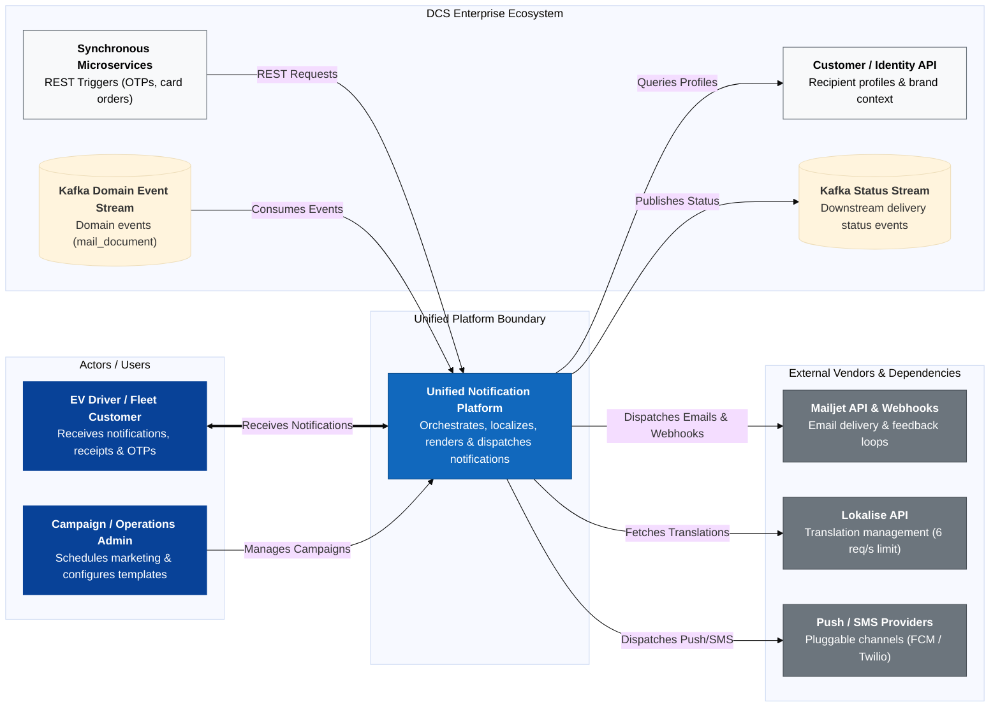
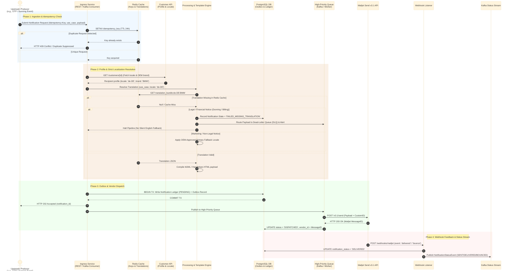

### Customer Notification Platform — Design Proposal
Read time: ~10–15 min

#### TL;DR
* **Problem**: DCS operates four overlapping, fragmented legacy notification systems (System 1 .NET Functions, System 2 Quarkus REST, System 3 Fastify Campaign Engine, System 4 Windows BIRT Engine capped at ~3,080 msgs/hr) sharing uncoordinated Mailjet and Lokalise accounts bounded by a strict 6 req/s token cap.
* **Proposal**: Build a single, high-throughput Unified Notification Platform providing dual-priority queueing, async Redis translation caching, transactional outbox pattern, and event-driven Mailjet webhook reconciliation.
* **Key Decisions**:
  1. *Transactional Outbox + Kafka*: Guarantees zero message loss and decouples downstream status reporting.
  2. *Async Redis Translation Cache + Strict Localization Validation*: Honors Lokalise's 6 req/s token cap and blocks non-compliant English fallbacks for legal dunning notices.
  3. *Dual-Priority Queueing*: Protects time-sensitive OTPs and dunning notices (< 2s SLA) from being blocked behind bulk marketing campaigns.
  4. *PostgreSQL + S3 Storage*: Uses PostgreSQL for ACID delivery ledgers and offloads HTML/PDF snapshots to S3 for 30-day compliance audits.
  5. *Domain Scope Boundary*: Billing Domain generates financial PDFs; Notification Platform handles layout wrappers and delivery.
* **Migration Plan**: Incremental Strangler Fig pattern across 4 phases, starting with Phase 0 shadow testing, migrating System 4 by consuming the existing `mail_document` Kafka stream in Phase 2, and concluding with full legacy decommissioning.

---

#### 1. Problem Framing
Digital Charging Solutions (DCS) powers EV charging communications across multiple automotive OEMs and Fleet products. Over time, four overlapping, independently built email systems have accumulated significant technical debt:
* **System 1 (Fleet Transactional)**: .NET Azure Functions firing direct, fire-and-forget HTTP requests to Mailjet, lacking database auditing, retries, or execution logs.
* **System 2 (Generalized Transactional)**: Quarkus/Kotlin REST service with PostgreSQL auditing, Service Bus webhook publishing, and JobRunr retries.
* **System 3 (Bulk / Campaign Sender)**: Node/Fastify campaign engine using BullMQ, Redis, server-side MJML rendering, and recipient HTML snapshot audits, but lacking webhook ingestion and transactional APIs.
* **System 4 (Legacy Billing Engine)**: Embedded BIRT report engine running on a Windows VM with a severe hard cap of **~3,080 emails/hr** (~0.85 msgs/sec), manual SSH/Perl translation syncs, and database polling.

These systems share two fragile downstream dependencies: a single shared **Mailjet** account and a **Lokalise** translation instance bounded by a strict rate limit of **6 req/sec per token**. Uncoordinated traffic bursts risk hitting rate limits, causing message dropouts, and propagating vendor latency directly to core user flows.

##### Grouped Issues
* **Reliability & Auditing**: System 1 uses fire-and-forget HTTP calls without DB logging, leading to untraceable lost messages during vendor glitches.
* **Vendor Risk & Rate Limits**: Live hot-path calls to Lokalise risk hitting the 6 req/s token cap, causing rendering failures during traffic spikes.
* **Performance Bottlenecks**: System 4 BIRT engine SQL polling caps sends at ~0.85 msgs/sec, delaying critical billing communications.
* **SLA Protection**: Lack of priority queueing allows massive marketing campaigns to block urgent OTPs and legal dunning notices.
* **Compliance & Content Drift**: Silent English fallbacks in System 1 produce non-compliant English dunning notices for German drivers, exposing the business to regulatory risk.

##### Scope and Non-Goals
* **In-Scope (Notification Platform Domain)**:
  * Unified REST ingress API & Kafka event consumers.
  * Template wrapper compilation (MJML/Handlebars), dynamic multi-OEM brand injection, and pre-send locale coverage validation.
  * Dual-priority queueing and vendor adapter dispatch to Mailjet Send v3.1.
  * Mailjet webhook ingestion, ACID status ledger updates in PostgreSQL, and publishing downstream events to Kafka Status Stream.
  * Pluggable multi-channel architecture (Push/SMS).
* **Out-of-Scope (Non-Goals)**:
  * **Financial PDF Document Generation**: Calculating financial line items or executing heavy BIRT tax reports is owned by the **Billing Domain**. The Notification Platform accepts pre-rendered PDF links/blobs and handles wrapper rendering and delivery.
  * **Translation Authoring & Storage**: Lokalise remains the authoritative source of truth for translations. The platform only syncs and caches localized text.
  * **Customer Profile Management**: Customer email, locale, and OEM brand associations are owned by the **Customer/Identity API**.
  * **Physical Email Delivery**: Direct SMTP infrastructure is outsourced to **Mailjet**.

---

#### 2. Assumptions and Open Questions

| # | Category | Assumption & Technical Baseline | Architectural Impact |
|---|---|---|---|
| A1 | **Throughput & Capacity** | Peak transactional throughput is **500 msgs/sec**; bulk campaign bursts reach **2,000 msgs/sec**. | Fully eliminates System 4's ~3,080 msgs/hr (~0.85 msgs/sec) hard cap. |
| A2 | **Latency SLAs** | High-priority transactional emails (OTPs, card orders, legal dunning) require **P99 < 2,000ms** to Mailjet dispatch. Bulk campaigns have a **15-minute batch SLA**. | Mandates dual-priority queue isolation to prevent head-of-line blocking. |
| A3 | **Vendor Constraints** | Lokalise API enforces a strict rate cap of **6 req/sec per token**. Mailjet operates via Send v3.1 REST API & Webhooks. | Prohibits live Lokalise REST calls on rendering hot-paths; requires async Redis caching. |
| A4 | **Ecosystem Capabilities** | A Customer/Identity API resolves recipient contact details and locale. An existing Kafka topic carries legacy `mail_document` change events. | Allows Phase 2 migration to consume the existing event stream directly without building new CDC tooling. |
| A5 | **Audit & Retention** | Rendered message HTML snapshots must be retained for **30 days** for audit/compliance, then anonymized for GDPR. | Offloads large HTML/PDF blobs to S3/Blob Storage to prevent PostgreSQL bloat. |

##### Open Questions
1. What are the specific OEM partner SLA reporting requirements for notification delivery during partner audits?
2. Are there specific regional storage requirements (e.g., EU data residency) for S3 rendered snapshot buckets?
3. What is the target deprecation schedule for legacy mobile push mechanisms before onboarding them to the unified platform?

---

#### 3. Requirements

##### Functional Requirements
* **Unified Ingress**: Provide REST endpoints for real-time transactional requests (OTPs, card orders) and Kafka event consumers for domain triggers (dunning, billing updates).
* **Idempotency & Deduplication**: Enforce a 24-hour idempotency window on incoming requests via `Idempotency-Key` headers in Redis.
* **Multi-OEM Branding**: Dynamically inject OEM-specific layouts, assets, and per-OEM verified sender domains based on tenant context.
* **Strict Localization Validation**: Intersect recipient preferred locales with local Redis translation coverage prior to dispatch. For legal/financial notices (dunning), missing translations must **block the send and route to a Dead-Letter Queue (DLQ)** with immediate alerting, rather than falling back silently to English.
* **Status Reconciliation & Publishing**: Ingest Mailjet delivery, bounce, and open webhooks, update PostgreSQL status ledger, and publish standardized delivery events to a downstream Kafka status stream.

##### Non-Functional Requirements
* **Resiliency & Circuit Breaking**: Maintain 99.9% availability with automated circuit breakers to buffer outbound messages in Redis/Kafka during Mailjet outages.
* **SLA Protection**: Guarantee zero head-of-line blocking where high-priority transactional emails wait behind bulk marketing campaigns.
* **Audit Compliance**: Persist immutable rendered message snapshots in cheap object storage with automated 30-day lifecycle retention policies.
* **Observability**: Propagate distributed correlation IDs across REST ingress, Kafka queues, template compilers, and webhook reconcilers for end-to-end tracing.

---

#### 4. Architecture

##### 4.1 System Context (C4 L1)

##### 4.2 Containers (C4 L2)

```mermaid
%%{init: {'theme': 'base', 'themeVariables': { 'fontSize': '16px', 'nodePadding': '12' }}}%%
flowchart LR
  %% C4 Level 2: Container Architecture Diagram (GitHub Native)

  subgraph Producers ["Upstream Producers & Clients"]
    restClients["<b>Synchronous Microservices</b><br/>(OTPs, Card Orders)"]
    kafkaProducer[("<b>Kafka Event Stream</b><br/>(Billing, Dunning Events)")]
    adminUI["<b>Campaign Admin UI</b><br/>(React / TypeScript)"]
  end

  subgraph PlatformBoundary ["Unified Notification Platform"]

    subgraph IngressLayer ["1. Ingress & Trigger Layer"]
      restApi["<b>REST Ingress API</b><br/>(Quarkus / Kotlin)<br/>Low-latency sync endpoint"]
      kafkaConsumer["<b>Kafka Event Consumer</b><br/>(Quarkus / Kotlin)<br/>Asynchronous event listener"]
      campaignApi["<b>Campaign Service</b><br/>(Node / Fastify)<br/>Batching & cohort scheduling"]
    end

    subgraph ProcessingLayer ["2. Processing & Validation Engine"]
      processor["<b>Core Processing Engine</b><br/>- Idempotency & Dedup Check<br/>- Profile & Locale Resolution<br/>- Strict Pre-Send Coverage Check"]
    end

    subgraph LocalizationLayer ["3. Localization & Template Engine"]
      templateEngine["<b>MJML/Handlebars Compiler</b><br/>Compiles HTML & brand layouts"]
      lokaliseSync["<b>Lokalise Sync Worker</b><br/>Async translation fetcher"]
    end

    subgraph QueueLayer ["4. Dual-Priority Queueing & Dispatch"]
      highPriorityQ[("<b>High-Priority Queue</b><br/>Kafka Topic / InMemory<br/>(OTPs, Dunning - < 2s SLA)")]
      lowPriorityQ[("<b>Low-Priority Queue</b><br/>Redis + BullMQ<br/>(Bulk / Throttled Campaigns)")]
      dispatcher["<b>Vendor Dispatcher</b><br/>Mailjet Send v3.1 Adapter<br/>(Rate limiting & retries)"]
    end

    subgraph FeedbackLayer ["5. Status & Webhook Reconciliation"]
      webhookHandler["<b>Webhook Receiver</b><br/>Ingests Mailjet events"]
      statusPublisher["<b>Status Reconciler</b><br/>Updates DB & emits Kafka status"]
    end

    subgraph StorageLayer ["6. Storage Layer"]
      postgres[("<b>PostgreSQL DB</b><br/>Metadata, outbox, status ledger")]
      redis[("<b>Redis Datastore</b><br/>Idempotency keys, Lokalise cache, BullMQ")]
      s3Store[("<b>S3 / Azure Blob Storage</b><br/>Rendered HTML/PDF audit snapshots")]
    end

  end

  subgraph SharedServices ["External Vendors & Shared Ecosystem"]
    customerApi["<b>Customer / Identity API</b>"]
    lokaliseApi["<b>Lokalise API</b><br/>(6 req/s limit)"]
    mailjetApi["<b>Mailjet Send API & Webhooks</b>"]
    kafkaStatusStream[("<b>Kafka Status Stream</b>")]
  end

  %% Ingress Flows
  restClients -->|"1a. HTTP POST"| restApi
  kafkaProducer -->|"1b. Consume Event"| kafkaConsumer
  adminUI -->|"1c. Schedule Campaign"| campaignApi

  restApi & kafkaConsumer & campaignApi -->|"2. Process Request"| processor

  %% Processing & Storage Interactions
  processor <-->|"Idempotency & Cache"| redis
  processor -->|"Write Outbox / Ledger"| postgres
  processor -->|"Fetch Profile"| customerApi

  %% Localization Flows
  processor -->|"3. Render Template"| templateEngine
  templateEngine <-->|"Read Translation Cache"| redis
  lokaliseSync -->|"Async Sync (Bypasses Limit)"| lokaliseApi
  lokaliseSync -->|"Populate Cache"| redis

  %% Queueing & Dispatch Flows
  templateEngine -->|"4a. High-Priority"| highPriorityQ
  templateEngine -->|"4b. Low-Priority"| lowPriorityQ
  templateEngine -->|"Save Snapshot (30d)"| s3Store

  highPriorityQ & lowPriorityQ -->|"5. Pull Jobs"| dispatcher
  dispatcher -->|"6. Send Email Payload"| mailjetApi

  %% Webhook Feedback Loop
  mailjetApi -->|"7. Webhook POST"| webhookHandler
  webhookHandler -->|"8. Reconcile"| statusPublisher
  statusPublisher -->|"Update Status"| postgres
  statusPublisher -->|"Publish Event"| kafkaStatusStream

  %% Styling
  classDef producerStyle fill:#084298,stroke:#084298,color:#fff;
  classDef containerStyle fill:#1168bd,stroke:#0b4884,color:#fff;
  classDef queueStyle fill:#d97706,stroke:#b45309,color:#fff;
  classDef dbStyle fill:#15803d,stroke:#166534,color:#fff;
  classDef extStyle fill:#6c757d,stroke:#495057,color:#fff;

  class restClients,kafkaProducer,adminUI producerStyle;
  class restApi,kafkaConsumer,campaignApi,processor,templateEngine,lokaliseSync,dispatcher,webhookHandler,statusPublisher containerStyle;
  class highPriorityQ,lowPriorityQ queueStyle;
  class postgres,redis,s3Store dbStyle;
  class customerApi,lokaliseApi,mailjetApi,kafkaStatusStream extStyle;
```

##### 4.3 Key Flows (Sequence Diagram)

---

#### 5. Architectural Trade-offs Matrix

| # | Area | Selected Option | Rejected Alternative | Architectural Justification |
|---|---|---|---|---|
| 1 | **Ingestion Pattern** | Transactional Outbox + Kafka | Synchronous Vendor Calls | Eliminates vendor latency coupling & guarantees at-least-once delivery without dropping notifications during vendor outages. |
| 2 | **Localization** | Local Redis Cache + Strict Pre-Send Validation | Live Lokalise REST API & Silent English Fallback | Satisfies Lokalise's strict 6 req/s token cap while preventing illegal/non-compliant English fallbacks on German legal dunning notices. |
| 3 | **Queueing** | Dual-Priority Queues (High-Priority Kafka vs. Throttled BullMQ) | Single Shared FIFO Queue | Isolates time-sensitive OTPs and legal dunning notices (< 2s SLA) from head-of-line blocking behind 50k bulk marketing campaign runs. |
| 4 | **Metadata Store** | PostgreSQL + JSONB | NoSQL Document Store | Guarantees transactional ACID safety for delivery status state transitions while storing flexible template payload variables in JSONB. |
| 5 | **Snapshot Storage** | S3 / Azure Blob Storage | PostgreSQL Blob Columns | Offloads large rendered HTML/PDF payloads to cheap object storage, preventing database bloat while satisfying 30-day compliance audit retention. |
| 6 | **Template Engine** | Server-Side MJML / Handlebars Compiler | Mailjet Hosted Templates | Provides Git version control, multi-OEM branding isolation, zero vendor lock-in, and local pre-send coverage checks. |
| 7 | **Delivery Tracking** | Webhook Ingestion + Kafka Status Stream | Active Vendor API Polling | Provides real-time event-driven delivery feedback downstream without wasting bandwidth or hitting Mailjet polling rate limits. |

---

#### 6. Core Entities, Storage and Consistency

##### Core Data Entities
* **`NotificationRequest`**: Stores incoming request metadata (`id`, `idempotency_key`, `use_case`, `channel`, `recipient_id`, `oem_brand`, `locale`, `status`, timestamps).
* **`OutboxMessage`**: Tracks pending outbound dispatch jobs (`id`, `aggregate_type`, `aggregate_id`, `payload`, `status`, `retry_count`, `next_retry_at`).
* **`CampaignCohort`**: Manages bulk campaign batch execution (`id`, `campaign_name`, `oem_brand`, `total_recipients`, `processed_count`, `status`).
* **`BlockedRecipient`**: Maintains opt-out/unsubscribe lists per OEM brand and communication category (`recipient_id`, `oem_brand`, `category`, `reason`).

##### Consistency Model
* **Strong Transactional Consistency (ACID)**: Required for request recording, idempotency key acquisition, and Outbox table writes inside PostgreSQL.
* **Eventual Consistency**: Applied to Mailjet webhook delivery feedback reconciliation and downstream Kafka status event streaming.

##### Idempotency & Retention
* **Idempotency**: 24-hour enforcement window managed via `SETNX` in Redis.
* **Data Lifecycle & GDPR**: Rendered HTML/PDF audit snapshots in S3 automatically expire after 30 days via S3 Lifecycle rules. PII fields in PostgreSQL status logs are anonymized via background cleanup jobs after 90 days.

---

#### 7. Deep Dive: Transactional Ingestion, Localization & Status Reconciliation

##### Rationale
Real-time transactional notifications (OTPs, card orders, legal dunning notices) carry the highest operational and compliance risk. Delays breach < 2s SLAs, lost messages break critical driver journeys, and incorrect language fallbacks violate consumer protection regulations.

##### System Defenses & Failure Modes
* **Lokalise API Outage or Rate Limit Hit**: The hot-path rendering engine queries the local Redis translation cache exclusively. An active background worker syncs keys asynchronously, completely isolating runtime message execution from Lokalise's 6 req/s token cap.
* **Mailjet API Degradation / HTTP 503**: Circuit breakers in the Vendor Dispatcher trip on consecutive errors, pausing queue consumers and safely buffering payloads in Kafka/Redis with exponential backoff retries. Zero messages are lost.
* **Poison Pill Payload**: Malformed payloads or unresolvable recipient IDs are routed to a Dead-Letter Queue (DLQ) after 3 retry attempts, triggering an operator alert without blocking the rest of the queue.

---

#### 8. Evolution and Migration (Strangler Fig Pattern)

##### Phased Rollout Schedule

###### Phase 0: Platform Foundation & Shadow Dual-Writing
* **Goal**: Validate platform stability, template compilation, and vendor integrations in production without sending duplicate live emails.
* **Key Actions**:
  1. Deploy core infrastructure (PostgreSQL, Redis, Kafka Ingress Consumers, Mailjet Adapter).
  2. Implement **Shadow Dual-Writing**: Mirror a small percentage of live transactional triggers to the Unified Engine. The Unified Engine renders templates and performs validation, but suppresses the final HTTP dispatch call to Mailjet.
  3. Benchmark P99 rendering latency and verify template parity against legacy outputs.

###### Phase 1: Migrate System 1 (Fleet Transactional .NET Azure Functions)
* **Why First?**: Low operational complexity, but high risk in production due to lack of retries, DB ledgers, and audit logs.
* **Key Actions**:
  1. Point Fleet microservices to the Unified Platform's `/v1/notifications` REST API via Feature Flag.
  2. Gain immediate ACID audit logging, idempotency checks, and automated Mailjet retries.
  3. Decommission Azure Functions and associated legacy repositories.

###### Phase 2: Migrate System 4 (Legacy BIRT / Billing Events)
* **Baseline**: System 4 currently caps sends at ~3,080 emails/hr via manual SQL triggers on `oi_mail_document`.
* **Key Actions**:
  1. Subscribe the Unified Platform's Kafka Consumer directly to the **existing `mail_document` Kafka change-event stream** (which dunning migrations already use).
  2. Map incoming `mail_document` event payloads (dunning notices, order confirmations) directly into the **High-Priority Transactional Pipeline**.
  3. Render localized notification wrappers around pre-generated billing attachments (from Billing Domain) and dispatch via Mailjet.
  4. Decommission the legacy Windows VM, BIRT engine, and manual Perl/SSH content sync scripts.

###### Phase 3: Migrate System 2 (Quarkus REST) & System 3 (Campaign Engine)
* **Key Actions**:
  1. Reroute remaining synchronous REST endpoints from System 2 to the Unified REST Ingress API.
  2. Point the Campaign Admin UI (System 3) to the unified Campaign API and migrate campaign scheduling to the **BullMQ/Redis Low-Priority Queue**.
  3. Migrate historical delivery tracking tables and active subscriber lists to the unified PostgreSQL database.

###### Phase 4: Final Cutover & Legacy Decommissioning
* **Key Actions**:
  1. Perform final audit reconciliation to confirm 100% traffic migration across all OEM brands.
  2. Remove routing feature flags and hard-decommission System 2 and System 3 infrastructure, databases, and Service Bus topics.

---

#### 9. Risks and What I'd Do Next

| Risk Scenario | Mitigation Strategy | Fallback Plan |
|---|---|---|
| **Template Rendering Drift** | Automated snapshot comparison during Phase 0 shadow testing. | Instant feature flag toggle back to legacy template path per OEM brand. |
| **Mailjet API Outage / Throttling** | Circuit breakers and exponential backoff retries in Vendor Adapter. | Buffer payloads safely in Redis / Kafka until vendor recovers; zero message loss. |
| **Missing Translation Key in Redis** | Strict Pre-Send Validation Check. For legal/dunning, block send and route to DLQ with alert. | For non-legal marketing, apply OEM-configured primary fallback language. |
| **Database Migration Instability** | Dual-writing status logs to both legacy and unified databases during cutover. | Roll back DNS/routing rules to legacy services within seconds. |

##### Next Steps & Future Enhancements
1. **Multi-Channel Expansion**: Implement generic `NotificationChannelAdapter` drivers for Mobile Push (Firebase FCM) and SMS (Twilio).
2. **Advanced Analytics**: Build real-time open/click-through rate dashboards by consuming the downstream Kafka status stream into Elasticsearch/Grafana.
3. **In-App Notification Center**: Expose a driver-facing inbox API allowing EV drivers to view historical notifications directly inside OEM mobile apps.
