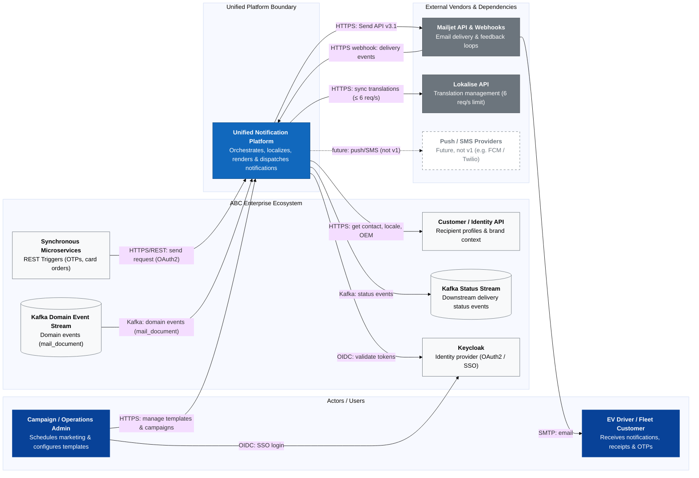
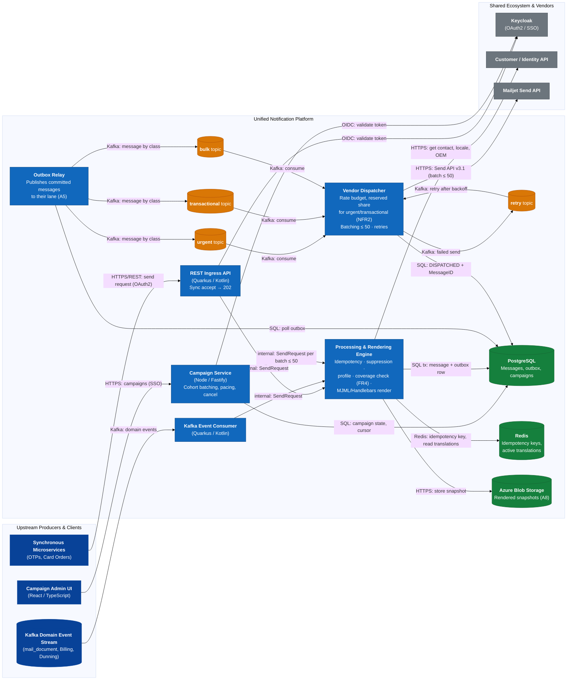
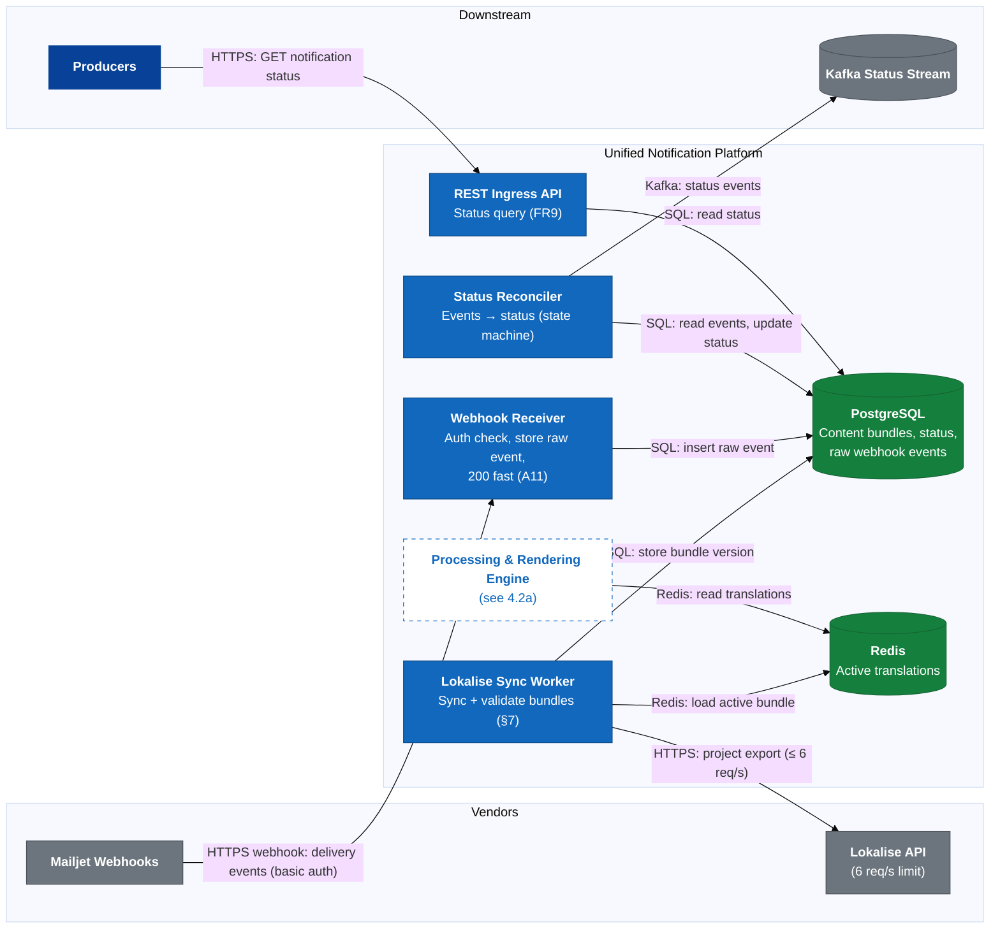
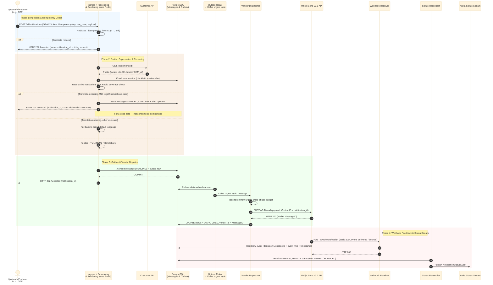
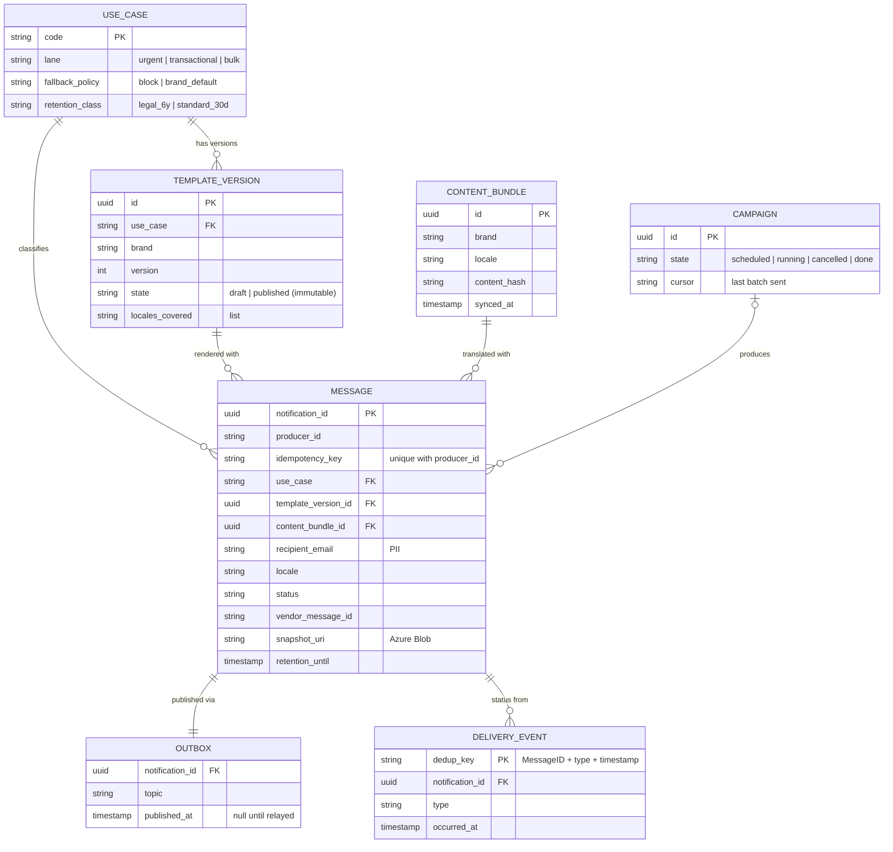
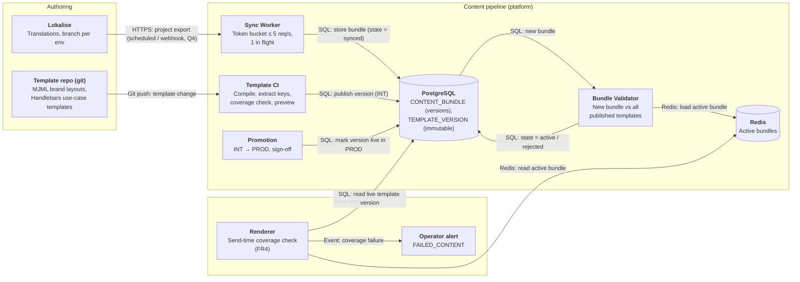

# Customer Notification Platform — Design Proposal

> Read time: ~10–15 min

## 1. Problem framing
### **Problem Statement**
ABC powers EV charging communications across multiple automotive OEMs and Fleet products. Over time, four overlapping, independently built email systems have accumulated significant technical debt:
* **System 1 (Fleet Transactional)**: .NET Azure Functions with direct, fire-and-forget HTTP calls to Mailjet, lacking database auditing, retries, or execution logs.
* **System 2 (Generalized Transactional)**: Quarkus/Kotlin REST service with PostgreSQL auditing, Service Bus webhook publishing, and JobRunr retries.
* **System 3 (Bulk / Campaign Sender)**: Node/Fastify campaign engine using BullMQ, Redis, server-side MJML rendering, and recipient HTML snapshot audits, but lacking webhook ingestion and transactional APIs.
* **System 4 (Legacy Billing Engine)**: Embedded BIRT report engine running on a Windows VM with a severe hard cap of **~3,080 emails/hr** (~0.85 msgs/sec), manual SSH/Perl translation syncs, and database polling.

All four share one **Mailjet** account and one **Lokalise** instance, each through a different integration — which creates the problems below.

### Problems this setup creates
<!-- Each bullet: problem → consequence for customer/business → (systems). 2–4 bullets per group. -->

<!-- DRAFT NOTES — rewrite P1–P6 and Severity in your own words before submitting; delete this comment after. -->

#### P1 — Content drift
* Lokalise content reaches customers four different ways: S1 build-time into Mailjet templates, S2 render-time merge, S3 MJML, S4 manual Perl/SSH sync → the same notice can differ by system and brand, and a stale path goes unnoticed.
* Missing translation → silent EN fallback (S1) or a broken/wrong email (Figure 1).
* Only S3 validates locale coverage before sending; the other three have no such control.

#### P2 — Reliability and status visibility
* S1 is fire-and-forget with no retry → a Mailjet error loses the email silently. S4's only "retry" is re-inserting the row.
* Status is fragmented: S2 publishes on Service Bus, S3 polls, S1/S4 have nothing → support can't answer "did customer X get notice Y?" in one place.

#### P3 — Shared vendor risk
* One Mailjet account = one sender reputation → a bulk campaign or bounce spike can push OTPs/receipts into spam for every OEM.
* Four systems compete for the same sending limits with no coordination.
* One set of credentials spread over four codebases → large blast radius if leaked.
* Lokalise: 6 req/token shared by four uncoordinated consumers.

#### P4 — Compliance and data protection
* S4 test sends use real customer data → GDPR exposure.
* No audit trail in S1/S4 → no proof that a legal notice (e.g. dunning) was sent, or what it said.
* Retention/anonymisation exists only in S3.

#### P5 — Operability and people risk
* S4: single expert, no repo, VM near end of life.
* Bulk sends are a manual SQL-and-preview ritual with product-owner sign-off.
* INT→PROD promotion is manual and has shipped broken banners.
* Hourly job → up to 1 h latency; hard cap ~3,080 emails/hr.

#### P6 — Cost of change
* A new OEM or use case may have to be built up to four times, in four stacks (.NET, Kotlin, Node, BIRT).
* Capabilities (retry, status, validation) exist unevenly → a fix in one system doesn't help the others.

### Severity
* P1 is customer-visible, silent, and affects every brand.
* For legal/price notices, wrong content is a legal risk, not a cosmetic one.
* Only a unified content pipeline fixes P1; P2 could be patched system by system.
* S4 (P5) is urgent but already moving (dunning now reads from Kafka).

---
### Scope and non-goals
#### **In-Scope (Notification Platform Domain)**
* **Unified Ingress**: REST API endpoints for real-time transactional requests and Kafka consumers for domain event triggers.
* **Orchestration & Rendering**: Template wrapper compilation (MJML/Handlebars), dynamic multi-OEM brand injection, and pre-send locale validation.
* **Priority Queueing & Dispatch**: Dual-lane processing separating sub-2-second transactional requests from throttled bulk campaigns.
* **Delivery Status Reconciliation**: Ingesting Mailjet webhooks, maintaining an ACID status ledger, and emitting standardized events onto a Kafka status stream.
* **Campaign Management**: Operator UI for cohorts, scheduling and cancel (carried over from System 3).
* **Template & Content Lifecycle**: Versioning, preview, locale-coverage check at publish time, and controlled INT→PROD promotion.
* **Suppression**: Blocklist and unsubscribe handling (carried over from System 2).
* **Attachments**: Legal PDFs and Billing-supplied documents.
* **Retention & GDPR**: Retention periods and anonymisation of stored messages.
* **Channels**: Email only in v1; channel is an extension point so push/SMS can be added later without changing orchestration.

#### **Out-of-Scope (Non-Goals)**
* **Financial Document Generation**: Invoices, dunning letters as PDF documents and their financial line items are owned by the **Billing Domain**, which passes them to the platform as attachments. The platform owns the *message*: the ~95 BIRT email templates (dunning levels, login info, order confirmation, …) are ported into the platform's template pipeline. Who generates the PDFs once BIRT is retired is an open question for Billing.
* **Translation Authoring & Storage**: Lokalise remains the authoritative source of truth for translations. The platform only syncs and caches localized text.
* **Customer Profile Management**: Customer email, locale, and OEM brand associations are owned by the **Customer/Identity API**.
* **Physical Email Delivery**: Direct SMTP infrastructure is outsourced to **Mailjet**.

---

## 2. Assumptions and open questions
### 2.1 Explicit Assumptions

**Type:** *Given* = stated in the brief · *Assumed* = not in the brief, my estimate of ABC today · *Target* = what the new platform must meet.

| # | Type | Category | Assumption | Architectural Impact |
| :--- | :--- | :--- | :--- | :--- |
| A1 | Assumed → Target | **Transactional volume** | ~2 M active customers across OEMs/Fleet × ~10 transactional msgs/customer/month ≈ 20 M/month ≈ 8 msg/s average; peak ≈ 10× ≈ **80 msg/s**. Target: **design for 300 msg/s** (headroom for growth/new OEMs). Today S4 is capped at ~0.85 msg/s (Given). | Sizes workers, topic partitions, and load on the Customer API. |
| A2 | Assumed → Target | **Bulk volume** | Largest campaign ≈ **2 M recipients**, to complete within **4 h** ≈ 140 msg/s, throttled. | Bulk is rate-limited by the platform, not sent as fast as possible. |
| A3 | Assumed | **Mailjet ceiling** | The shared account's sending limit is unknown (Q1) and caps the whole platform. The platform enforces a **split rate budget** under it, with reserved capacity for transactional. | Bulk cannot starve OTPs at the vendor; drives dispatcher design. |
| A4 | Assumed | **Webhook volume** | ~3 Mailjet events per message (sent, delivered, open/bounce) → up to ~3× send rate inbound. | Sizes the webhook receiver; must be idempotent (events can repeat). |
| A5 | Target | **Latency classes** | **Urgent** (OTP, verification): P99 < 2 s accept → Mailjet. **Transactional** (receipts, card orders, dunning, legal): P99 < 5 min, must deliver with audit trail. **Bulk**: within 4 h (A2). | Separate lanes per class; dunning optimised for correctness, not speed. |
| A6 | Given | **Vendor constraints** | Lokalise: **6 req/s per token**, max 1 concurrent request per token. Mailjet: Send API v3.1 + webhooks, per-OEM verified senders. | No live Lokalise calls on the send path; content synced ahead of time. |
| A7 | Given | **Ecosystem** | A Customer/Identity API resolves contact details, locale and OEM. An existing Kafka stream carries legacy `mail_document` change events. | Phase 2 migration consumes the existing stream; no new CDC tooling. |
| A8 | Assumed → Target | **Retention** | **Legal/financial notices**: metadata + rendered snapshot kept **6 years** (pending Q3). **OTP / other transactional / marketing**: snapshots **30 days**, then deleted. Status metadata: **1 year**. | Blob lifecycle tiers per class; GDPR deletion job; large blobs kept out of PostgreSQL. |
| A9 | Assumed | **Cloud** | **Azure** — S1 runs on Azure Functions and S2 uses Azure Service Bus. | Blob Storage, managed Postgres/Redis on Azure; no multi-cloud. |
| A10 | Assumed | **Team** | One platform team of ~5–6 engineers. | Few deployables; favour managed services over self-run infra. |
| A11 | Assumed | **Mailjet integration** | Mailjet webhooks carry **no signature** → authenticated with **basic auth credentials in the webhook URL** over HTTPS. Mailjet **retries** webhook calls that don't get a 200, so events can arrive late or more than once. Send API v3.1 accepts **up to 50 messages per call**. Mailjet **sub-accounts** exist (whether ABC can use them: Q2). | Webhook receiver checks credentials, returns 200 fast (store first, process async) and is idempotent. Dispatcher batches bulk sends to reduce API calls under the rate budget (A3). |
| A12 | Assumed | **Service authentication** | ABC already runs **Keycloak** (S3 uses it — Given) and it can serve as the platform's identity provider. Producers call the API with **OAuth2 client-credentials** tokens; operators use Keycloak SSO with roles. | No custom auth. Per-producer clients allow per-use-case authorisation (e.g. Fleet can only trigger Fleet use cases) and per-producer rate limits. |

---

### 2.2 Open questions for ABC
* **Q1 Mailjet throughput:** What is the shared account's sending limit? It caps the whole platform (A3).
* **Q2 Mailjet sub-accounts:** Can we split by OEM and/or transactional vs bulk to isolate sender reputation (P3)?
* **Q3 Legal retention:** How long must dunning/legal notices be kept as proof of sending? A8 assumes 6 years.
* **Q4 Lokalise webhooks:** Does our plan support webhooks, or must sync be scheduled polling?
* **Q5 Billing PDFs:** Who generates invoice/dunning PDFs once BIRT is retired?
* **Q6 Tracking:** Are open/click events allowed on transactional mail (ePrivacy), or only delivery/bounce?
* **Q7 Cohorts:** Who owns campaign cohort definitions — the platform or a CRM/marketing system?

## 3. Core System Requirements

### 3.1 Functional Requirements

| # | Requirement | Traces to |
| :--- | :--- | :--- |
| FR1 | **Unified ingress:** one API for synchronous requests and an event consumer for domain events, both using the same use-case model. | P6 |
| FR2 | **Idempotency on every path:** duplicate requests are not resent. REST uses an `Idempotency-Key` header (24 h window), events use the event ID, campaigns use campaign + recipient. The dispatcher must not double-send when it retries after a Mailjet timeout. | P2 |
| FR3 | **Multi-OEM branding:** layout, assets and verified sender domain are chosen from the OEM/tenant context. | P1, P6 |
| FR4 | **Locale coverage validation, in two places:** (a) when a template version is *published*, block it if locales are missing; (b) when a message is *sent*, check again. The fallback policy is set per use case: legal/financial notices **block and alert** (held in a `FAILED_CONTENT` state, operator alerted); others may fall back to the brand default language. | P1 |
| FR5 | **Template & content lifecycle:** versioned templates, preview with synthetic data, controlled INT→PROD promotion. | P1, P5 |
| FR6 | **Campaigns:** operators define cohorts, schedule, throttle and cancel bulk sends. | P5 |
| FR7 | **Suppression:** blocklist and unsubscribe are checked before every send; marketing respects opt-out. | P4 |
| FR8 | **Attachments:** accept Billing-supplied PDFs by reference. | Scope |
| FR9 | **Status:** ingest Mailjet delivery events, keep one status per message, publish status events downstream, and expose a status query API. | P2 |
| FR10 | **Test sends:** non-production environments never send to real customers (allowlist or sink). | P4 |
| FR11 | **GDPR:** erase or anonymise a customer's messages on request and according to retention (A8). | P4 |

### 3.2 Non-Functional Requirements

| # | Requirement | Traces to |
| :--- | :--- | :--- |
| NFR1 | **Availability:** the ingress API accepts requests 99.9% of the time. During a Mailjet outage, messages are buffered durably and sent after recovery, with no loss. End-to-end delivery is bounded by Mailjet. | P2, A3 |
| NFR2 | **Lane isolation:** urgent sends meet A5 even while a bulk campaign is running, through separate lanes **and** a reserved share of the Mailjet rate budget. | P3, A3, A5 |
| NFR3 | **Scale:** 300 msg/s transactional (A1), 140 msg/s bulk (A2), ~3× inbound webhooks (A4). | A1, A2, A4 |
| NFR4 | **Delivery semantics:** at-least-once internally, with deduplication (FR2) so customers effectively receive each message once. | P2 |
| NFR5 | **Auditability:** for every message, keep the rendered snapshot, template version and status history, for as long as A8 requires. | P4 |
| NFR6 | **Security:** producers authenticate via OAuth2 client credentials (A12); Mailjet webhooks authenticated per A11; per-OEM credentials kept in a secret store; no PII in logs; encryption at rest; role-based access for operators (A12). | P3, P4, A11, A12 |
| NFR7 | **Observability:** a correlation ID runs from ingress to webhook. Alerts fire on hold/failure queues, bounce-rate spikes and Mailjet error rates. | P2, P5 |

## 4. Architecture

### 4.1 System context (C4 L1)

### 4.2 Containers (C4 L2)
Split in two for legibility: **4.2a** the send path, **4.2b** content sync and status feedback. Rendering is a component inside the Processing Engine (detailed in §7), not a separate deployable.

#### 4.2a Send path

#### 4.2b Content sync and status feedback

### 4.3 Key flows

## 5. Architectural Trade-offs Matrix

The eight decisions that shape the design, each with the alternative I rejected. #8 is a decision *not* to add something.

| # | Area | Decision | Rejected alternative | Why | Traces to |
|---|---|---|---|---|---|
| 1 | Send path | **Transactional outbox + async dispatch.** API stores message + outbox row in one transaction and returns 202; a relay publishes to Kafka. | Synchronous Mailjet call in the request (as S1); or write DB then publish directly (dual write). | Mailjet slowness/outage doesn't reach producers. DB and Kafka never disagree — no lost or phantom messages. Delivery is at-least-once via retries + dedup (FR2). | P2, NFR1, NFR4 |
| 2 | Localisation | **Lokalise content synced ahead of time** into a local cache (scheduled; webhook-triggered if available, Q4). Rendering reads only the cache. | Live Lokalise calls at render time. | 6 req/s, 1 concurrent (A6) can't serve 300 msg/s (A1); a Lokalise outage would block sends. **Cost:** content can be minutes stale → covered by publish-time coverage check (FR4). | P1, A6, FR4 |
| 3 | Lanes | **Three Kafka topics by class** (urgent / transactional / bulk) + **dispatcher rate budget with reserved share** for urgent/transactional. | One shared FIFO queue. | A 2 M campaign (A2) would delay OTPs past 2 s (A5). Separate topics alone aren't enough because the Mailjet limit is shared (A3) — the reserved budget is the actual guarantee. | A2, A3, A5, NFR2 |
| 4 | Metadata store | **PostgreSQL** for messages, outbox, status, campaigns. | NoSQL document store (e.g. Cosmos DB). | Outbox needs message + outbox row in one ACID transaction; status transitions need constraints. S2/S3 already use Postgres → team knowledge, easier migration. ~20 M msgs/month (A1) fits Postgres with monthly partitions. | NFR4, A1, A10 |
| 5 | Snapshot storage | **Azure Blob Storage** with lifecycle rules per retention class. | Snapshots in PostgreSQL. | HTML/PDF blobs would bloat the DB and backups. Lifecycle rules apply A8 (6 y legal, 30 d others) automatically. | A8, A9, NFR5 |
| 6 | Templates | **Platform renders** (MJML + Handlebars); templates versioned in git. | Mailjet-hosted templates (as S1). | One content pipeline fixes drift (P1); preview + coverage check before publish (FR4, FR5); no vendor lock-in of content. **Cost:** we own rendering performance. | P1, FR4, FR5 |
| 7 | Status | **Mailjet webhooks ingested** (store first, reconcile async) and published on Kafka. | Polling Mailjet (as S3). | Near real-time; no polling load on the shared Mailjet API limit. Idempotent processing handles retries/duplicates (A11). | P2, A4, A11, FR9 |
| 8 | **Not** a second queue technology | **Kafka for all lanes, including bulk.** Campaign pacing and cancel live in the Campaign Service (state in Postgres). | Redis + BullMQ for bulk (as S3). | One broker to run for a 5–6-person team (A10); Kafka already exists (A7) and is durable. **Cost:** no native delay/cancel → retry topic + upstream pacing. | A7, A10, NFR1 |

## 6. Core entities, storage and consistency

### 6.1 Ownership
| Data | Owner | Platform holds |
| :--- | :--- | :--- |
| Translations | **Lokalise** | Synced copy (`ContentBundle`), read-only |
| Customer contact, locale, OEM | **Customer/Identity API** | Values *as used at send time*, on the `Message` (audit) |
| Invoice / dunning PDFs | **Billing** | Reference (URI) only |
| Templates, messages, status, campaigns, suppression | **Platform** | Source of truth (PostgreSQL + Blob) |

### 6.2 Core entities

Also: `SUPPRESSION` (email hash + brand + reason) and campaign `COHORT` — omitted from the diagram for brevity.

**Message status** — a forward-only state machine; out-of-order webhooks never move it backwards (A11):
`PENDING → DISPATCHED → DELIVERED | BOUNCED`, with terminal side states `FAILED_CONTENT`, `SUPPRESSED`, `FAILED`.

### 6.3 Consistency
| Boundary | Model | Why |
| :--- | :--- | :--- |
| Message + outbox row | **Strong** — one PostgreSQL transaction | A message is never queued without a record, or recorded without being queued (Decision #1). |
| Status transitions | **Strong** — conditional update (`WHERE status` in allowed predecessors) | Concurrent/out-of-order webhooks can't corrupt state. |
| Outbox → Kafka lanes → dispatcher | **Eventual**, at-least-once | Duplicates absorbed by idempotency (below). |
| Status stream to consumers | **Eventual**, keyed by `notification_id` | Per-message ordering; consumers don't need global order. |
| Translation cache vs Lokalise | **Eventual** (minutes) | Rate limit (A6); publish-time coverage check catches gaps (FR4). |
| Customer profile | Read at send time, stored on the message | The audit shows what was actually used, even if the profile changes later. |

### 6.4 Idempotency (three layers)
1. **Ingress**: Redis `SET NX` on (producer, key) for 24 h — fast path; PostgreSQL unique constraint on (`producer_id`, `idempotency_key`) — durable backstop if Redis loses the key.
2. **Dispatch**: before calling Mailjet, the dispatcher checks the message is still `PENDING`; `CustomID = notification_id` lets us trace a send that timed out.
3. **Webhooks**: `DELIVERY_EVENT.dedup_key` primary key — repeated deliveries are ignored.

### 6.5 Retention and GDPR
* `retention_until` is set at creation from the use case's retention class (A8). `MESSAGE` is **partitioned by month** → expiry is a partition drop, not mass deletes.
* Snapshots in Blob follow the same class via lifecycle rules.
* **Erasure request**: delete snapshots and null `recipient_email` for non-legal messages. Legal/financial notices are kept until `retention_until` (legal-obligation exception, GDPR Art. 17(3)(b)), then deleted.
* Non-production uses synthetic data only (FR10).

## 7. Deep dive: the content pipeline

**Why this area:** content drift (P1) is the most severe problem, it is where the four systems differ most (four Lokalise integrations, three template technologies), it carries the legal risk (wrong-language dunning), and it is the bulk of the migration work (~16 S1 + ~95 BIRT templates). Queues and retries are well-understood patterns; getting the *right words to the right customer in the right brand* is the part specific to ABC.

### 7.1 Invariants
* **I1** — No message is sent with a template that hasn't passed coverage validation for the brand and locale it's sent in.
* **I2** — Every sent message records the exact template version and content bundle used, so any email can be reproduced (NFR5).
* **I3** — Lokalise is never on the send path; sync stays within 6 req/s, 1 concurrent (A6).
* **I4** — The same validated artefact is promoted INT → PROD; nothing is rebuilt or hand-copied per environment (fixes S4's broken banners, P5).

### 7.2 Components (C4 L3)

### 7.3 How content changes flow
**Translation change (Lokalise → platform)**
1. The Sync Worker exports each Lokalise project as one bundle (one export call per project, not per key → far below A6) and stores it as a new immutable `CONTENT_BUNDLE` version in state `synced`.
2. The Bundle Validator checks the new bundle against every **published** template that uses it: all referenced keys present for every (brand, locale) the use case requires.
3. Pass → bundle becomes `active` and is loaded into Redis. Fail → bundle is `rejected`, the **previous active bundle keeps serving**, and the content owner is alerted with the missing keys.

**Template change (git → platform)**
1. A merge request triggers CI: compile MJML, extract the translation keys used, check coverage against the active bundle for every required (brand, locale), render previews with synthetic data (FR5, FR10).
2. Pass → an immutable `TEMPLATE_VERSION` is published to INT. A reviewer checks previews and signs off; **the same version** is marked live in PROD (I4).
3. Rollback = point the use case back to the previous version — instant, since versions are immutable.

**Send time**
* The Renderer uses the live template version + active bundle, and still checks coverage for the recipient's actual locale (a customer locale may not be in the template's required set). Missing → FR4 policy: legal → `FAILED_CONTENT` + alert; others → brand default language. The message records both version ids (I2).

### 7.4 Failure modes
| Failure | Effect | Handling |
| :--- | :--- | :--- |
| Lokalise down or rate-limited | No new content | Keep serving the last active bundle; sync backs off; alert if a bundle is older than the staleness threshold. |
| Translator deletes/empties keys | New bundle would break templates | Bundle `rejected`; previous active bundle stays; content owner alerted. |
| Template uses a key that doesn't exist | — | CI fails; version can't be published. |
| Customer locale not covered by template | Send-time coverage miss | FR4 policy; metric per (use case, locale) so gaps are visible. |
| Broken layout reaches PROD | Wrong-looking emails | Preview + sign-off in INT; rollback to previous version in seconds. |
| Shared partial (e.g. brand footer) changed | Many templates affected | CI re-validates and re-previews every dependent template. |
| Redis cache lost | No bundles in cache | Rebuild from PostgreSQL (bundles are stored there); no Lokalise calls needed. |
| Bad payload data (missing variable) | Render error | Message `FAILED` with reason, visible via status API; producer alerted by status event. |

### 7.5 Trade-offs inside the pipeline
| Decision | Rejected alternative | Why |
| :--- | :--- | :--- |
| Activate a bundle only after validation (stale-but-correct) | Always use the latest sync (fresh-but-maybe-broken) | A missing translation in a legal notice is worse than a few hours' delay on a wording change. |
| Validate at publish **and** at send | Send time only | Most gaps are caught before any customer is affected; the send-time check covers what publish can't know (actual recipient locale). |
| Templates in git with review | Template editor in a DB/UI | Review, history and diff for free; fits a 5–6-person team (A10). **Cost:** marketing can't self-serve layout changes → campaign templates in a UI is a later evolution. |
| Render per message at send time | Pre-render every (template × brand × locale) at publish | Payload is per message; pre-rendering explodes combinations and still needs a send-time merge. |

### 7.6 Migrating existing content
* Order: S1's ~16 templates (small, proves the pipeline) → S4's ~95 BIRT templates (dunning first) → S2/S3.
* Each ported template runs in shadow mode (Phase 0); the parity diff compares text and links after normalising whitespace and tracking parameters.
* The S4 Perl/SSH sync and S1's build-time Mailjet template compile are retired as their templates move — one content path remains.

## 8. Evolution and migration
### **Phased Rollout Schedule**
Each use case moves independently behind a feature flag (strangler pattern); rollback is always "flip the flag back".

#### **Phase 0: Platform Foundation & Shadow Mode**
* **Goal**: Prove rendering parity and latency in production without sending anything.
* **Key Actions**:
    1. Deploy core infrastructure (PostgreSQL, Redis, Kafka topics, Mailjet adapter, Keycloak clients).
    2. **Shadow traffic**: for S4, a second consumer reads the existing `mail_document` stream in parallel; for REST systems, the compatibility facade (Phase 1) mirrors requests. The platform renders and validates but **suppresses the Mailjet call**.
    3. Diff rendered output against legacy output per template; measure P99 latency against A5.
* **Exit**: parity diff clean for 2 weeks on mirrored use cases; P99 within A5.

#### **Phase 1: Migrate System 1 (Fleet Transactional, .NET Azure Functions)**
* **Why first?** Highest risk for its size (no retry, no audit — P2, P4), small template set (~16 use cases), and its callers are internal Fleet services we can coordinate with.
* **Key Actions**:
    1. Deploy a thin **compatibility facade** for the ~16 `/v1/mail/*` endpoints that maps each call to the new `/v1/notifications` API — callers don't change.
    2. Port S1's Mailjet-hosted templates and bundled legal PDFs into the platform's template pipeline.
    3. Flip use cases one by one via feature flag; then decommission the Azure Functions.
* **Exit / rollback**: per use case, 2 weeks with no lost messages and status visible for every send; flag back to S1 otherwise. Facade retired once callers move to the new API natively.

#### **Phase 2: Migrate System 4 (Billing Engine / BIRT)**
* **Why second?** End-of-life VM with a single expert (P5) and the largest content set (P1); the existing `mail_document` stream makes it reachable without touching Billing's database. It goes after S1 so the platform is proven on live traffic first.
* **Key Actions**:
    1. Subscribe the platform's Kafka consumer to the existing `mail_document` change-event stream; route messages to the **transactional lane** (A5).
    2. Port the ~95 BIRT email templates into the platform, ordered by volume and risk (dunning first); Billing supplies invoice/dunning PDFs as attachments (Q5).
    3. **Status**: Billing consumes the platform's Kafka status stream instead of reading `oi_mail_document` states 1/10 (dependency on the Billing team).
    4. Decommission the Windows VM, BIRT engine and manual Perl/SSH sync scripts once all templates pass parity.
* **Exit / rollback**: per template, parity in shadow mode then live; until then that use case stays on S4.

#### **Phase 3: Migrate System 2 (Quarkus REST) & System 3 (Campaign Engine)**
* **Why last?** Both already have retries, audit and status (S2) or validation and snapshots (S3) — lowest risk today, and their strongest features are what the platform is built from.
* **Key Actions**:
    1. Reroute S2's use-case endpoints to the platform's REST API.
    2. **Status bridge**: publish platform status events to S2's existing Service Bus topic until downstream consumers move to the Kafka status stream.
    3. Point the Campaign Admin UI at the platform's Campaign Service; campaigns are sent through the Kafka **bulk** lane (Decision #8).
    4. Migrate S2/S3 status history, templates and cohorts to the platform's PostgreSQL in the background.
* **Exit / rollback**: per use case / campaign type via feature flag; legacy DBs stay read-only until decommissioned.

#### **Phase 4: Final Cutover & Decommissioning**
* **Key Actions**:
    1. Reconcile: confirm 100% of traffic for all OEMs goes through the platform (no sends from legacy Mailjet credentials).
    2. Remove the Service Bus bridge and S1 facade once no consumers remain.
    3. Remove feature flags; decommission S2 and S3 infrastructure, databases and Service Bus topics; rotate the shared Mailjet credentials.

---
## 9. Risks and what I'd do next
| Risk Scenario | Mitigation Strategy | Fallback Plan |
| :--- | :--- | :--- |
| **Template rendering drift during migration** | Shadow-render in Phase 0; automated diff against legacy output per template. | Feature flag back to the legacy path per use case / OEM. |
| **Mailjet outage / throttling** | Circuit breaker + backoff in the dispatcher; messages wait durably in Kafka/outbox (NFR1); urgent keeps its reserved budget (NFR2). | Resend after recovery. A second email vendor was **deliberately not added** (cost and complexity for a rare event); revisit if Mailjet's SLA proves insufficient. |
| **Translation cache lost or stale** | Synced content also stored in PostgreSQL → cache rebuilt without calling Lokalise; publish-time coverage check (FR4). | Legal notices held as `FAILED_CONTENT` + alert; others fall back to brand default language (FR4). |
| **Duplicate emails (at-least-once)** | Idempotency on every path (FR2); dispatcher sets `CustomID` = `notification_id` and checks status before retrying. | Accept rare duplicates for non-legal mail; monitor duplicate rate. |
| **Porting ~95 BIRT templates** | Port in order of volume and risk (dunning first); parity diff in shadow mode. | That use case stays on S4 until parity passes. |
| **Sender reputation damaged by bulk** | Separate Mailjet sub-accounts or sender domains for bulk vs transactional (Q2); bounce-rate alert (NFR7). | Auto-pause a campaign when bounce rate crosses a threshold. |
| **Two stacks (Kotlin + Node) for a small team** | Keep the Node Campaign Service only while migrating S3. | Fold it into Kotlin later if the team can't support both. |
| **Data migration from legacy DBs** | Migrate S2/S3 status history in the background; once a use case's flag flips, new sends go only to the new platform. | Feature flag back per use case; legacy DBs stay read-only until decommissioned. |

### Known weaknesses
* **Outbox polling adds latency to the urgent lane.** The relay's poll interval eats into the 2 s budget (A5). Mitigation: short poll interval for urgent rows; if that's not enough, switch the relay to CDC (e.g. Debezium on the PostgreSQL WAL).
* **Single region.** No disaster-recovery design yet; RPO/RTO not defined.
* **Four stateful components** (PostgreSQL, Kafka, Redis, Blob) for a small team (A10). Redis is the first candidate to remove (idempotency → Postgres constraint, cache → in-process).
* **Mailjet is a single vendor by choice** — an extended outage delays everything except what's already delivered.

### What I'd do next
1. **Answer Q1 and Q3 first** — the Mailjet throughput limit and legal retention change the rate budget and storage design most.
2. **Load-test the dispatcher** against the real Mailjet limit: an OTP's P99 while a 2 M campaign runs (NFR2).
3. **Define SLOs per lane and write runbooks** for `FAILED_CONTENT`, bounce spikes and Mailjet outages.
4. **Threat model** (STRIDE) for the ingress API, webhook endpoint and admin UI; secret rotation for per-OEM Mailjet credentials.
5. **Second deep dive: dispatch and lane isolation** — the rate-budget algorithm, back-pressure and circuit-breaker settings.
6. **Later evolution:** push/SMS behind the channel extension point (e.g. FCM, Twilio), customer channel preferences and consent, and a self-service template UI for marketing (the cost noted in 7.5).
