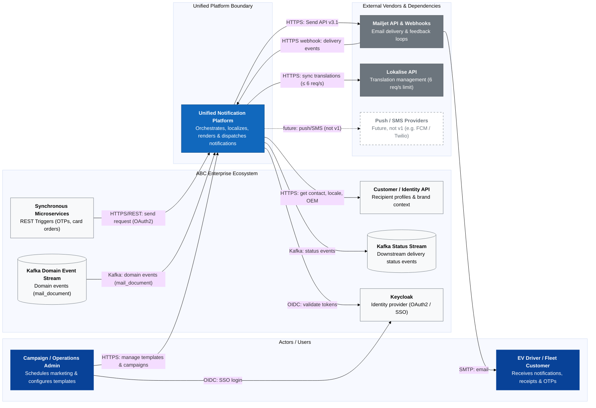
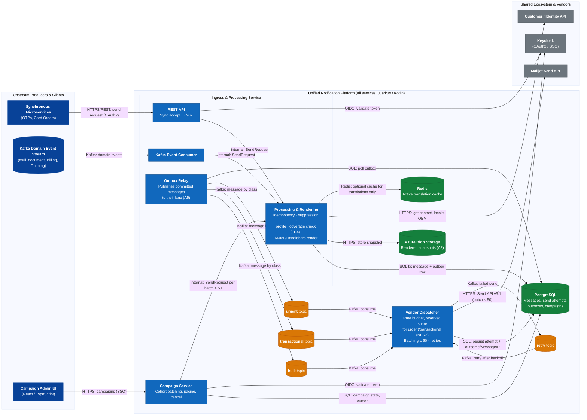
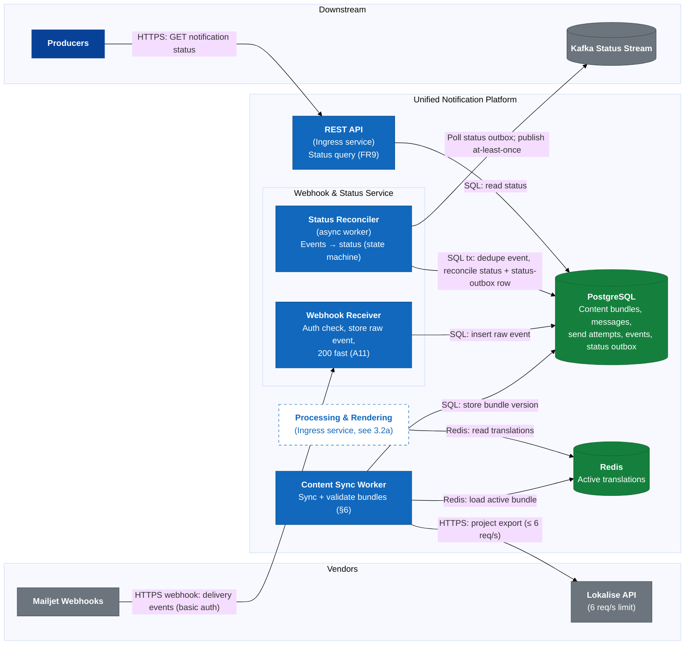
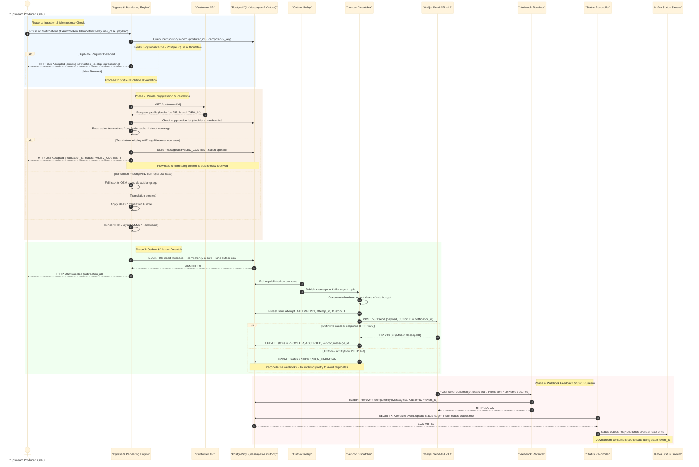
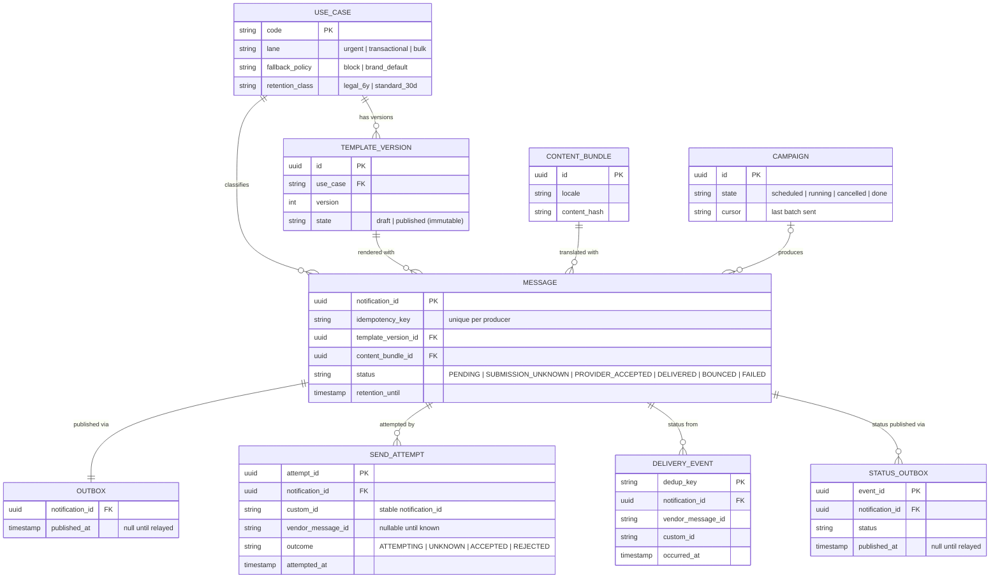
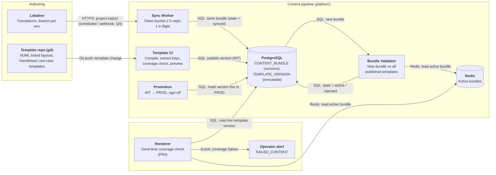

# Customer Notification Platform — Design Proposal

> Read time: ~10–15 min

## 1. Problem framing
### **Problem Statement**
ABC powers EV charging communications across multiple automotive OEMs and Fleet products. Over time, four overlapping, independently built email systems have accumulated significant technical debt:
* **System 1 (Fleet Transactional)**: .NET Azure Functions with direct, fire-and-forget HTTP calls to Mailjet, lacking database auditing, retries, or execution logs.
* **System 2 (Generalized Transactional)**: Quarkus/Kotlin REST service with PostgreSQL auditing, Service Bus webhook publishing, and JobRunr retries.
* **System 3 (Bulk / Campaign Sender)**: Node/Fastify campaign engine using BullMQ, Redis, server-side MJML rendering, and recipient HTML snapshot audits, but lacking webhook ingestion and transactional APIs.
* **System 4 (Legacy Billing Engine)**: Embedded BIRT report engine running on a Windows VM with a severe hard cap of **~3,080 emails/hr** (~0.85 msgs/sec), manual SSH/Perl translation syncs, and database polling.

All four share one **Mailjet** account and one **Lokalise** instance, each through a different integration — which creates the problems below.

### Problems this setup creates
<!-- Each bullet: problem → consequence for customer/business → (systems). 2–4 bullets per group. -->

#### P1 — Content drift
* Lokalise content reaches customers four different ways: S1 build-time into Mailjet templates, S2 render-time merge, S3 MJML, S4 manual Perl/SSH sync → the same notice can differ by system and brand, and a stale path goes unnoticed.
* Missing translation → silent EN fallback (S1) or a broken/wrong email (Figure 1).
* Only S3 validates locale coverage before sending; the other three have no such control.

#### P2 — Reliability and status visibility
* S1 is fire-and-forget with no retry → a Mailjet error loses the email silently. S4's only "retry" is re-inserting the row.
* Status is fragmented: S2 publishes on Service Bus, S3 polls, S1/S4 have nothing → support can't answer "did customer X get notice Y?" in one place.

#### P3 — Shared vendor risk
* One Mailjet account = one sender reputation → a bulk campaign or bounce spike can push OTPs/receipts into spam for every OEM.
* Four systems compete for the same sending limits with no coordination.
* One set of credentials spread over four codebases → large blast radius if leaked.
* Lokalise: 6 req/token shared by four uncoordinated consumers.

#### P4 — Compliance and data protection
* S4 test sends use real customer data → GDPR exposure.
* No audit trail in S1/S4 → no proof that a legal notice (e.g. dunning) was sent, or what it said.
* Retention/anonymisation exists only in S3.

#### P5 — Operability and people risk
* S4: single expert, no repo, VM near end of life.
* Bulk sends are a manual SQL-and-preview ritual with product-owner sign-off.
* INT→PROD promotion is manual and has shipped broken banners.
* Hourly job → up to 1 h latency; hard cap ~3,080 emails/hr.

#### P6 — Cost of change
* A new OEM or use case may have to be built up to four times, in four stacks (.NET, Kotlin, Node, BIRT).
* Capabilities (retry, status, validation) exist unevenly → a fix in one system doesn't help the others.

### Severity
* P1 is customer-visible, silent, and affects every brand.
* For legal/price notices, wrong content is a legal risk, not a cosmetic one.
* Only a unified content pipeline fixes P1; P2 could be patched system by system.
* S4 (P5) is urgent but already moving (dunning now reads from Kafka).

---
### Scope and non-goals
#### **In-Scope (Notification Platform Domain)**
* **Unified Ingress**: REST API endpoints for real-time transactional requests and Kafka consumers for domain event triggers.
* **Orchestration & Rendering**: Template wrapper compilation (MJML/Handlebars), dynamic multi-OEM brand injection, and pre-send locale validation.
* **Priority Queueing & Dispatch**: Dual-lane processing separating sub-2-second transactional requests from throttled bulk campaigns.
* **Delivery Status Reconciliation**: Ingesting Mailjet webhooks, maintaining an ACID status ledger, and emitting standardized events onto a Kafka status stream.
* **Campaign Management**: Operator UI for cohorts, scheduling and cancel (carried over from System 3).
* **Template & Content Lifecycle**: Versioning, preview, locale-coverage check at publish time, and controlled INT→PROD promotion.
* **Suppression**: Blocklist and unsubscribe handling (carried over from System 2).
* **Attachments**: Legal PDFs and Billing-supplied documents.
* **Retention & GDPR**: Retention periods and anonymisation of stored messages.
* **Channels**: Email only in v1; channel is an extension point so push/SMS can be added later without changing orchestration.

#### **Out-of-Scope (Non-Goals)**
* **Financial Document Generation**: Invoices, dunning letters as PDF documents and their financial line items are owned by the **Billing Domain**, which passes them to the platform as attachments. The platform owns the *message*: the ~95 BIRT email templates (dunning levels, login info, order confirmation, …) are ported into the platform's template pipeline. Who generates the PDFs once BIRT is retired is an open question for Billing.
* **Translation Authoring & Storage**: Lokalise remains the authoritative source of truth for translations. The platform only syncs and caches localized text.
* **Customer Profile Management**: Customer email, locale, and OEM brand associations are owned by the **Customer/Identity API**.
* **Physical Email Delivery**: Direct SMTP infrastructure is outsourced to **Mailjet**.

### Key quality requirements
* **Lane isolation** — OTPs meet < 2 s P99 even during a 2 M campaign (A3, A5).
* **Reliable processing** — durable buffering and at-least-once internal processing with idempotency; duplicate external sends are minimised, not absolutely preventable without provider-side idempotency.
* **Auditability** — every message traceable to template version, content and status, for its retention period (A8).
* **Security** — authenticated producers and webhooks, per-OEM secrets, no PII in logs (A11, A12).

Full functional / non-functional requirements (FR*/NFR* referenced below): [appendix](docs/appendix.md#requirements).

---

## 2. Assumptions and open questions
### 2.1 Assumptions
*Given* = from the brief · *Assumed* = my estimate · *Target* = what the platform must meet.

| # | Type | Assumption | Drives |
| :--- | :--- | :--- | :--- |
| A1 | Assumed → Target | **Transactional volume:** ~80 msg/s peak (2 M customers × 10 msgs/month, ×10 peak); design for **300 msg/s**. Today S4 caps at 0.85 msg/s. | Service and partition sizing |
| A2 | Assumed → Target | **Bulk:** largest campaign 2 M recipients in **4 h** ≈ 140 msg/s | Bulk is throttled |
| A3 | Assumed / open question | **Mailjet account limit** unknown (Q1). Peak design load is 300 transactional + ~140 bulk = **~440 messages/s aggregate**, before headroom; Mailjet must confirm this is achievable. | One shared rate budget; reserve urgent/transactional capacity and throttle bulk |
| A4 | Assumed | **Webhooks:** ~3 events per message | Webhook service sizing; idempotent |
| A5 | Target | **Latency:** urgent (OTP) P99 < 2 s · transactional (receipts, dunning) P99 < 5 min · bulk ≤ 4 h | Three lanes |
| A6 | Given | **Lokalise:** 6 req/s, 1 concurrent per token | Content synced ahead, never on the send path |
| A7 | Given | **Ecosystem:** Customer/Identity API; Kafka `mail_document` stream | S4 migration reuses the stream |
| A8 | Assumed → Target | **Retention:** legal notices 6 y (Q3); other snapshots 30 d; status 1 y | Retention per class, Blob lifecycle |
| A9 | Assumed | **Azure** (S1, S2 already on it) | Managed services, Blob Storage |
| A10 | Assumed | **Team** of 5–6 engineers | Few services, managed infra |
| A11 | Assumed | **Mailjet:** webhooks unsigned (basic auth in URL), retried, may repeat; ≤ 50 messages per send call | Store-first idempotent receiver; batching |
| A12 | Assumed | **Identity:** Keycloak (used by S3), OAuth2 client credentials | No custom auth |

The ~440 messages/s figure is an offered-load target, not a claim about Mailjet capacity. Batches of up to 50 reduce HTTP request count, not the number of recipient messages Mailjet must process. Until Q1 is confirmed, the dispatcher must enforce the provider’s actual account limit, reserve capacity for urgent traffic, and throttle or pause bulk first; if the confirmed limit cannot sustain the target, the 4-hour campaign objective must be revisited.

Full assumption detail and derivations: [appendix](docs/appendix.md#assumption-detail).

### 2.2 Open questions for ABC
* **Q1** Mailjet account sending limit? (caps everything, A3)
* **Q2** Mailjet sub-accounts per OEM / traffic class? (sender reputation, P3)
* **Q3** Legal retention for dunning/legal notices? (A8)
* **Q4** Lokalise webhooks on our plan, or scheduled sync only?
* **Q5** Who generates invoice/dunning PDFs once BIRT is retired?
* **Q6** Open/click tracking allowed on transactional mail?
* **Q7** Who owns campaign cohorts — platform or CRM?

## 3. Architecture

### 3.1 System context (C4 L1)

### 3.2 Containers (C4 L2)
Five services, all Quarkus / Kotlin. A component gets its own service only if it **scales, fails or deploys differently**:

| Service | Separate because |
| :--- | :--- |
| **Ingress & Processing** (REST API, Kafka consumer, rendering, outbox relay) | Scales with producer traffic; latency-critical path |
| **Campaign Service** | Different users (operators), bursty batch workload |
| **Dispatcher** | Single owner of the Mailjet rate budget; scales with send rate |
| **Webhook & Status** (receiver + reconciler) | Internet-facing; must answer 200 fast; bursts on Mailjet's schedule |
| **Content Sync Worker** | Scheduled; single instance (Lokalise allows 1 concurrent request) |

Diagrams split for legibility: **3.2a** the send path, **3.2b** content sync and status feedback.

#### 3.2a Send path

#### 3.2b Content sync and status feedback

### 3.3 Key flows

## 4. Key decisions
Eight decisions, each with the alternative I rejected. #8 is a decision *not* to add something.

| # | Decision | Rejected | Why | Traces |
|---|---|---|---|---|
| 1 | **Transactional outbox + async dispatch** — store message + outbox row in one transaction, return 202 | Sync Mailjet call (S1); dual write DB then Kafka | Mailjet slowness never reaches producers; DB and Kafka can't disagree | P2 |
| 2 | **Lokalise synced ahead into a local cache**; render reads only the cache | Live Lokalise calls at render time | 6 req/s (A6) can't serve 300 msg/s; Lokalise outage would block sends. Cost: content minutes stale | P1, A6 |
| 3 | **Three Kafka lanes + one enforced Mailjet rate budget** at the dispatcher | One shared FIFO queue or independent per-lane limits | Separate topics isolate backlog but do not create provider capacity. Reserve urgent capacity, cap transactional traffic, and throttle/pause bulk against the confirmed account limit | A3, A5 |
| 4 | **PostgreSQL** for messages, outbox, status, campaigns | NoSQL (e.g. Cosmos DB) | Outbox needs one ACID transaction; S2/S3 already on Postgres; ~20 M msgs/month fits with monthly partitions | A1 |
| 5 | **Azure Blob** for rendered snapshots, lifecycle per class | Snapshots in PostgreSQL | Keeps DB and backups small; lifecycle rules enforce A8 | A8 |
| 6 | **Platform renders** (MJML + Handlebars), templates in git | Mailjet-hosted templates (S1) | One content pipeline fixes drift; preview + coverage check before publish. Cost: we own rendering | P1 |
| 7 | **Ingest Mailjet webhooks**, store first, reconcile async | Polling Mailjet (S3) | Near real-time feedback; webhook evidence helps reconcile ambiguous send outcomes but does not guarantee provider-side deduplication | P2, A11 |
| 8 | **Not** a second queue: Kafka for all lanes incl. bulk | Redis + BullMQ for bulk (S3) | One broker for a 5–6-person team; Kafka already exists. Cost: retry topic + pacing upstream | A7, A10 |

## 5. Core entities, storage and consistency

### 5.1 Ownership
| Data | Owner | Platform holds |
| :--- | :--- | :--- |
| Translations | Lokalise | Synced, versioned copy |
| Customer contact, locale, OEM | Customer/Identity API | Values as used at send time (audit) |
| Invoice / dunning PDFs | Billing | Reference only |
| Templates, messages, status, campaigns | **Platform** | Source of truth (PostgreSQL + Blob) |

### 5.2 Core entities

**Message status** records the platform and provider lifecycle separately. A send attempt can be `ATTEMPTING`, `SUBMISSION_UNKNOWN`, `ACCEPTED`, or definitively `REJECTED`; the message can progress from `PENDING` to `PROVIDER_ACCEPTED` and then `DELIVERED` / `BOUNCED`, or reach `FAILED_CONTENT`, `SUPPRESSED`, or `FAILED`. Apply timestamped, idempotent event handling so late or out-of-order webhooks cannot regress terminal state. `sent` means the recipient SMTP server accepted the message, not that it reached the inbox.

### 5.3 Consistency
| Boundary | Model | Why |
| :--- | :--- | :--- |
| Ingress idempotency + message + lane outbox | **Strong** (one PostgreSQL transaction) | Retries return the same logical notification; Redis is not authoritative |
| Send attempts | **Durable state machine** | Ambiguous timeouts remain `SUBMISSION_UNKNOWN` until reconciled; no blind assumption of failure |
| Webhook event + status + status-outbox row | **Strong** (one PostgreSQL transaction) | Event processing and downstream publication intent cannot diverge |
| Kafka status stream | **Eventual**, at-least-once | Stable event IDs allow consumer deduplication |
| Translation cache vs Lokalise | **Eventual** (minutes) | Rate limit; publish-time check catches gaps |

**Idempotency** at ingress (database unique constraint), internal event processing (stable event IDs), and webhook ingestion (deduplication key). `CustomID` correlates a send with provider evidence; it is not treated as a provider-side idempotency key.
**Retention:** `retention_until` per class (A8); monthly partitions → expiry is a partition drop; legal notices are kept despite erasure requests until retention ends.

Idempotency and GDPR detail: [appendix](docs/appendix.md#entities-detail).

## 6. Deep dive: the content pipeline

**Why this area:** content drift (P1) is the most severe problem, the four systems differ most here, it carries the legal risk (wrong-language dunning), and it is most of the migration work (~110 templates). Queues are well-understood; getting the right words to the right customer in the right brand is what's specific to ABC.

### 6.1 Invariants
* **I1** — Nothing is sent with a template that hasn't passed coverage validation for its brand and locale.
* **I2** — Every message records the template version and content bundle used → any email can be reproduced.
* **I3** — Lokalise is never on the send path (A6).
* **I4** — The same validated version is promoted INT → PROD; nothing is rebuilt per environment.

### 6.2 Components (C4 L3)

### 6.3 How content changes flow
* **Translation change:** Sync Worker exports each Lokalise project as one bundle (few calls, well under A6) → Bundle Validator checks it against every published template → **pass: active · fail: rejected, previous bundle keeps serving, content owner alerted.**
* **Template change:** merge request → CI compiles, checks keys and coverage, renders previews → immutable version published to INT → sign-off → same version live in PROD. Rollback = point back to the previous version.
* **Send time:** Renderer re-checks coverage for the recipient's actual locale → missing: legal → `FAILED_CONTENT` + alert; others → brand default language.

**Key trade-off:** a bundle goes live only after validation — *stale but correct* beats *fresh but broken* for legal notices.

Failure modes, further trade-offs and content migration: [appendix](docs/appendix.md#content-pipeline-detail).

## 7. Evolution and migration
Strangler pattern: each use case moves independently behind a feature flag; rollback is always "flip the flag back".

| Phase | What moves | Why this order | Exit / rollback |
| :--- | :--- | :--- | :--- |
| **0 Foundation & shadow** | Platform deployed; real traffic mirrored (S4 via a parallel `mail_document` consumer, REST via the facade) — rendered and diffed, **never sent** | Prove parity and latency with zero customer risk | Parity clean 2 weeks; P99 within A5 |
| **1 S1 Fleet** | Compatibility facade for the ~16 `/v1/mail/*` endpoints (callers unchanged); Mailjet-hosted templates ported | Highest risk for its size (no retry, no audit); small; internal callers | Per use case: 2 weeks, no lost messages → decommission Azure Functions |
| **2 S4 Billing / BIRT** | `mail_document` stream → transactional lane; ~95 BIRT templates ported (dunning first); Billing supplies PDFs (Q5) and reads the Kafka status stream | End-of-life VM, single expert; after S1 so the platform is proven first | Per template parity; until then that use case stays on S4 → retire VM and Perl/SSH sync |
| **3 S2 + S3** | S2 endpoints rerouted; **Service Bus status bridge** until downstream consumers move to Kafka; S3 campaign logic ported to Kotlin, sent via the bulk lane | Lowest risk today — both already have retries/audit or validation | Per use case / campaign type; legacy DBs read-only |
| **4 Cutover** | Reconcile 100% traffic; remove bridge, facade, flags; decommission S2/S3; **rotate shared Mailjet credentials** | — | No sends from legacy credentials |

**Later evolution:** push/SMS behind the channel extension point; customer channel preferences; self-service template UI for marketing.

Full per-phase action lists: [appendix](docs/appendix.md#migration-detail).

---
## 8. Risks and what I'd do next

| Risk | Mitigation | Fallback |
| :--- | :--- | :--- |
| **Mailjet outage / throttling** | Circuit breaker + backoff; messages wait durably in Kafka/outbox; urgent keeps its reserved budget | Resume after recovery; reconcile ambiguous attempts before retrying. **No second vendor** by choice — revisit if Mailjet's SLA proves insufficient |
| **Ambiguous Mailjet send timeout** | Persist attempt before send; correlate with `CustomID`, `MessageID`, and webhook evidence; use `SUBMISSION_UNKNOWN` | If outcome remains unknowable, apply explicit duplicate-vs-loss policy; provider events do not prove exactly-once submission |
| **Duplicate emails** (at-least-once internal processing) | DB-backed ingress idempotency, stable notification IDs, attempt ledger, webhook deduplication | Minimise duplicates; external duplicate prevention depends on provider capabilities |
| **Sender reputation hit by bulk** | Separate sub-accounts or sender domains for bulk (Q2); bounce-rate alert | Auto-pause the campaign |
| **Template drift while porting ~110 templates** | Shadow render + parity diff per template; dunning first | Flag back to the legacy path per use case |

**Known weaknesses:** outbox polling adds latency to the 2 s urgent lane (short poll for urgent; CDC if needed) · single region, RPO/RTO undefined · Redis is an optional translation cache, not a correctness dependency, and should remain only if load tests justify it.

**What I'd do next**
1. Answer Q1 (Mailjet limit) and Q3 (legal retention) — they move the design most.
2. Load-test an OTP's P99 during a 2 M campaign.
3. SLOs per lane and runbooks (`FAILED_CONTENT`, bounce spikes, Mailjet outage).
4. Threat model the API, webhook endpoint and admin UI; rotate per-OEM secrets.

Full risk register and weaknesses: [appendix](docs/appendix.md#risks-detail).
