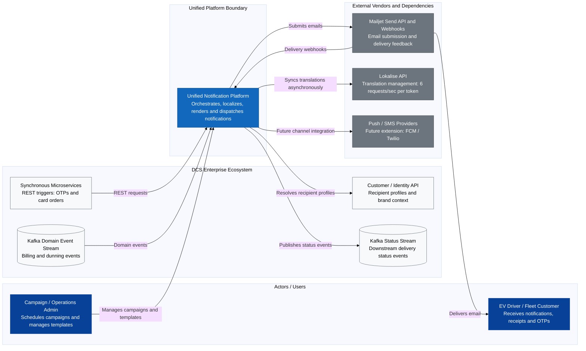
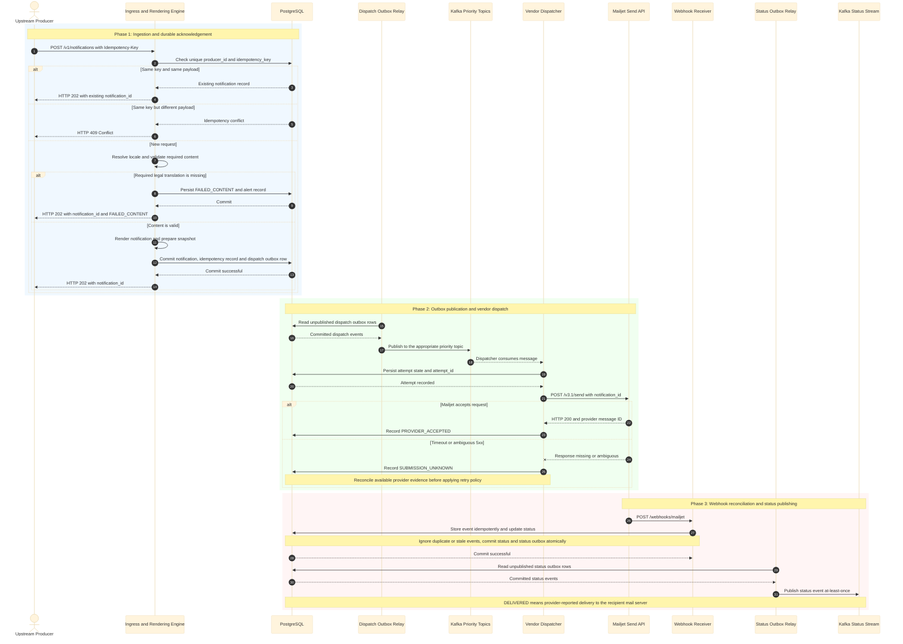

### Customer Notification Platform — Design Proposal
Read time: ~10–15 min

#### TL;DR
* **Problem**: DCS operates four overlapping, fragmented legacy notification systems (System 1 .NET Functions, System 2 Quarkus REST, System 3 Fastify Campaign Engine, System 4 Windows BIRT Engine capped at ~3,080 msgs/hr) sharing uncoordinated Mailjet and Lokalise accounts bounded by a strict 6 req/s token cap.
* **Proposal**: Build a single, high-throughput Unified Notification Platform providing dual-priority queueing, async Redis translation caching, transactional outbox pattern, and event-driven Mailjet webhook reconciliation.
* **Key Decisions**:
  1. *Durable Ingestion*: PostgreSQL transactions and an outbox support reliable, at-least-once dispatch processing; they do not guarantee final email delivery.
  2. *Localization*: A rate-limited background sync and Redis cache keep Lokalise calls off the request hot path. Missing required legal content blocks dispatch.
  3. *Priority Isolation*: Separate Kafka topics and reserved dispatcher capacity protect urgent traffic from bulk queue backlog, subject to shared Mailjet limits.
  4. *Storage & Audit*: PostgreSQL stores notification metadata and status; object storage holds rendered snapshots under a defined retention policy.
  5. *Domain Boundary*: Billing owns financial document generation; the Notification Platform owns message orchestration and delivery.
* **Migration Plan**: Incremental Strangler Fig pattern across 4 phases, starting with Phase 0 shadow testing, migrating System 4 by consuming the existing `mail_document` Kafka stream in Phase 2, and concluding with full legacy decommissioning.

---

#### 1. Problem Framing
Digital Charging Solutions (DCS) powers EV charging communications across multiple automotive OEMs and Fleet products. Over time, four overlapping, independently built email systems have accumulated significant technical debt:
* **System 1 (Fleet Transactional)**: .NET Azure Functions firing direct, fire-and-forget HTTP requests to Mailjet, lacking database auditing, retries, or execution logs.
* **System 2 (Generalized Transactional)**: Quarkus/Kotlin REST service with PostgreSQL auditing, Service Bus webhook publishing, and JobRunr retries.
* **System 3 (Bulk / Campaign Sender)**: Node/Fastify campaign engine using BullMQ, Redis, server-side MJML rendering, and recipient HTML snapshot audits, but lacking webhook ingestion and transactional APIs.
* **System 4 (Legacy Billing Engine)**: Embedded BIRT report engine running on a Windows VM with a severe hard cap of **~3,080 emails/hr** (~0.85 msgs/sec), manual SSH/Perl translation syncs, and database polling.

These systems share two fragile downstream dependencies: a single shared **Mailjet** account and a **Lokalise** translation instance bounded by a strict rate limit of **6 req/sec per token**. Uncoordinated traffic bursts risk hitting rate limits, causing message dropouts, and propagating vendor latency directly to core user flows.

##### Grouped Issues
* **Reliability & Auditing**: System 1 uses fire-and-forget HTTP calls without DB logging, leading to untraceable lost messages during vendor glitches.
* **Vendor Risk & Rate Limits**: Live hot-path calls to Lokalise risk hitting the 6 req/s token cap, causing rendering failures during traffic spikes.
* **Performance Bottlenecks**: System 4 BIRT engine SQL polling caps sends at ~0.85 msgs/sec, delaying critical billing communications.
* **SLA Protection**: Lack of priority queueing allows massive marketing campaigns to block urgent OTPs and legal dunning notices.
* **Compliance & Content Drift**: Silent English fallbacks in System 1 produce non-compliant English dunning notices for German drivers, exposing the business to regulatory risk.

##### Scope and Non-Goals
* **In-Scope (Notification Platform Domain)**:
  * Unified REST ingress API & Kafka event consumers.
  * Template wrapper compilation (MJML/Handlebars), dynamic multi-OEM brand injection, and pre-send locale coverage validation.
  * Dual-priority queueing and vendor adapter dispatch to Mailjet Send v3.1.
  * Mailjet webhook ingestion, ACID status ledger updates in PostgreSQL, and publishing downstream events to Kafka Status Stream.
  * Pluggable multi-channel architecture (Push/SMS).
* **Out-of-Scope (Non-Goals)**:
  * **Financial PDF Document Generation**: Calculating financial line items or executing heavy BIRT tax reports is owned by the **Billing Domain**. The Notification Platform accepts pre-rendered PDF links/blobs and handles wrapper rendering and delivery.
  * **Translation Authoring & Storage**: Lokalise remains the authoritative source of truth for translations. The platform only syncs and caches localized text.
  * **Customer Profile Management**: Customer email, locale, and OEM brand associations are owned by the **Customer/Identity API**.
  * **Physical Email Delivery**: Direct SMTP infrastructure is outsourced to **Mailjet**.

---

#### 2. Assumptions and Open Questions

| # | Category | Assumption & Technical Baseline | Architectural Impact |
|---|---|---|---|
| A1 | **Throughput & Capacity** | Assumed peak transactional ingress is **500 requests/sec** and bulk enqueue throughput is **2,000 recipients/sec**. | Durable buffering and independent worker scaling; actual dispatch capacity depends on Mailjet limits. |
| A2 | **Latency & Campaign SLA** | Target high-priority P99 is **under 2 seconds to provider dispatch attempt**. A 15-minute campaign SLA depends on verified provider capacity. | Separate priority lanes and reserved dispatch capacity; validate targets with load tests. |
| A3 | **Vendor Constraints** | Lokalise API enforces a strict rate cap of **6 req/sec per token**. Mailjet operates via Send v3.1 REST API & Webhooks. | Prohibits live Lokalise REST calls on rendering hot-paths; requires async Redis caching. |
| A4 | **Ecosystem Capabilities** | A Customer/Identity API resolves recipient contact details and locale. An existing Kafka topic carries legacy `mail_document` change events. | Allows Phase 2 migration to consume the existing event stream directly without building new CDC tooling. |
| A5 | **Audit & Retention** | Rendered snapshots are retained for 30 days as a provisional assumption; operational-record PII anonymisation after 90 days is a separate policy requiring approval. | Store snapshots in object storage and apply separately managed lifecycle policies. |

**Capacity check:** A 2-million-recipient campaign needs ~2,223 sends/sec to finish in 15 minutes; at 2,000/sec, dispatch takes ~16 minutes 40 seconds, excluding overhead and retries.

##### Open Questions
1. What are Mailjet's actual throughput limits, and what evidence or mechanism is available to reconcile ambiguous send outcomes?
2. What are the agreed latency/SLA definitions and approved retention requirements for notification content and delivery records?

---

#### 3. Requirements

##### Functional Requirements
* **Unified Ingress**: Provide REST endpoints for real-time transactional requests (OTPs, card orders) and Kafka event consumers for domain triggers (dunning, billing updates).
* **Idempotency & Deduplication**: Enforce a 24-hour client idempotency window using `Idempotency-Key` and an authoritative PostgreSQL unique constraint on `(producer_id, idempotency_key)`. Redis is optional and must not be required for correctness.
* **Multi-OEM Branding**: Dynamically inject OEM-specific layouts, assets, and per-OEM verified sender domains based on tenant context.
* **Strict Localization Validation**: Intersect recipient preferred locales with local Redis translation coverage prior to dispatch. For legal/financial notices (dunning), missing translations must **block the send**: the notification is persisted as `FAILED_CONTENT` with immediate operator alerting, rather than falling back silently to English.
* **Status Reconciliation & Publishing**: Ingest Mailjet delivery, bounce, and open webhooks, update PostgreSQL status ledger, and publish standardized delivery events to a downstream Kafka status stream.

##### Non-Functional Requirements
* **Resiliency & Circuit Breaking**: Maintain 99.9% availability with automated circuit breakers and durable Kafka buffering during Mailjet outages.
* **SLA Protection**: Reduce head-of-line blocking through separate priority topics and reserved dispatch capacity; actual latency depends on provider availability and rate limits.
* **Audit Compliance**: Persist immutable rendered message snapshots in cheap object storage with automated lifecycle retention policies (30 days, provisional — see A5).
* **Observability**: Propagate distributed correlation IDs across REST ingress, Kafka queues, template compilers, and webhook reconcilers for end-to-end tracing.

---

#### 4. Architecture

##### 4.1 System Context (C4 L1)

##### 4.2 Containers (C4 L2)

```mermaid
%%{init: {'theme': 'base', 'themeVariables': { 'fontSize': '14px', 'nodePadding': '10' }}}%%
flowchart LR
  subgraph Producers ["Upstream Producers and Clients"]
    restClients["Synchronous Microservices<br/>OTPs and card orders"]
    kafkaProducer[("Kafka Domain Events<br/>Billing and dunning")]
    adminUI["Campaign Admin UI<br/>React / TypeScript"]
  end

  subgraph Platform ["Unified Notification Platform"]

    subgraph Ingress ["1. Ingress and Trigger Layer"]
      restApi["REST Ingress API<br/>Quarkus / Kotlin"]
      kafkaConsumer["Kafka Event Consumer<br/>Quarkus / Kotlin"]
      campaignApi["Campaign Service<br/>Campaign scheduling and batching"]
    end

    subgraph Processing ["2. Processing and Validation"]
      processor["Core Processing Engine<br/>Idempotency, profile resolution,<br/>locale and content validation"]
      templateEngine["MJML / Handlebars Renderer<br/>HTML and OEM branding"]
    end

    subgraph Localization ["3. Localization"]
      lokaliseSync["Rate-Limited Sync Worker<br/>Maximum 6 requests/sec per token"]
      redis[("Redis<br/>Translation cache and optional lookup cache")]
    end

    subgraph Storage ["4. Durable Storage"]
      postgres[("PostgreSQL<br/>Notifications, idempotency,<br/>dispatch outbox and status ledger")]
      snapshots[("S3 / Azure Blob Storage<br/>Rendered content snapshots")]
    end

    subgraph Dispatch ["5. Queueing and Dispatch"]
      outboxRelay["Dispatch Outbox Relay<br/>Publishes committed outbox events"]
      highPriorityQ[("High-Priority Kafka Topic<br/>OTPs and urgent notifications")]
      lowPriorityQ[("Bulk Kafka Topic<br/>Campaign recipients")]
      dispatcher["Vendor Dispatcher<br/>Mailjet adapter, global rate limit,<br/>reserved urgent capacity and retries"]
    end

    subgraph Feedback ["6. Status Reconciliation"]
      webhookHandler["Webhook Receiver<br/>Validates Mailjet events"]
      statusReconciler["Status Reconciler<br/>Deduplicates events and updates status"]
      statusOutboxRelay["Status Outbox Relay<br/>Publishes committed status events"]
    end
  end

  subgraph Shared ["External Services"]
    customerApi["Customer / Identity API"]
    lokaliseApi["Lokalise API"]
    mailjetApi["Mailjet Send API and Webhooks"]
    kafkaStatusStream[("Kafka Status Stream")]
  end

  restClients -->|"HTTP POST"| restApi
  kafkaProducer -->|"Domain events"| kafkaConsumer
  adminUI -->|"Campaign commands"| campaignApi

  restApi --> processor
  kafkaConsumer --> processor
  campaignApi --> processor

  processor -->|"Resolve recipient"| customerApi
  processor -->|"Check translation coverage"| redis
  processor -->|"Render message"| templateEngine
  templateEngine -->|"Read cached translations"| redis
  templateEngine -->|"Save rendered snapshot"| snapshots

  lokaliseSync -->|"Rate-limited async sync"| lokaliseApi
  lokaliseSync -->|"Refresh translation cache"| redis

  processor -->|"Commit notification and dispatch outbox"| postgres
  postgres -->|"Committed outbox rows"| outboxRelay
  outboxRelay -->|"Route by priority"| highPriorityQ
  outboxRelay -->|"Route by priority"| lowPriorityQ

  highPriorityQ -->|"Consume urgent messages"| dispatcher
  lowPriorityQ -->|"Consume bulk messages"| dispatcher
  dispatcher -->|"Rate-limited send attempt"| mailjetApi

  mailjetApi -->|"Webhook POST"| webhookHandler
  webhookHandler -->|"Validate and reconcile"| statusReconciler
  statusReconciler -->|"Update status and write status outbox"| postgres
  postgres -->|"Committed status outbox rows"| statusOutboxRelay
  statusOutboxRelay -->|"Publish at-least-once"| kafkaStatusStream

  classDef producerStyle fill:#084298,stroke:#084298,color:#fff;
  classDef containerStyle fill:#1168bd,stroke:#0b4884,color:#fff;
  classDef queueStyle fill:#d97706,stroke:#b45309,color:#fff;
  classDef dbStyle fill:#15803d,stroke:#166534,color:#fff;
  classDef extStyle fill:#6c757d,stroke:#495057,color:#fff;

  class restClients,kafkaProducer,adminUI producerStyle;
  class restApi,kafkaConsumer,campaignApi,processor,templateEngine,lokaliseSync,outboxRelay,dispatcher,webhookHandler,statusReconciler,statusOutboxRelay containerStyle;
  class highPriorityQ,lowPriorityQ queueStyle;
  class postgres,redis,snapshots,kafkaStatusStream dbStyle;
  class customerApi,lokaliseApi,mailjetApi extStyle;
```

##### 4.3 Key Flows (Sequence Diagram)

---

#### 5. Architectural Trade-offs Matrix

| # | Area | Selected Option | Rejected Alternative | Architectural Justification |
|---|---|---|---|---|
| 1 | **Ingestion Pattern** | Transactional Outbox + Kafka | Synchronous Vendor Calls | Decouples request acceptance from vendor availability and supports durable, at-least-once processing with retryable event publication. |
| 2 | **Localization** | Local Redis Cache + Strict Pre-Send Validation | Live Lokalise REST API & Silent English Fallback | Satisfies Lokalise's strict 6 req/s token cap while preventing illegal/non-compliant English fallbacks on German legal dunning notices. |
| 3 | **Queueing** | Separate Kafka topics for urgent and bulk traffic, with reserved dispatcher capacity | One shared FIFO queue | Reduces cross-lane head-of-line blocking. Both lanes still share Mailjet limits, so the dispatcher must enforce a global rate limit and reserve capacity for urgent traffic. |
| 4 | **Metadata Store** | PostgreSQL + JSONB | NoSQL Document Store | Guarantees transactional ACID safety for delivery status state transitions while storing flexible template payload variables in JSONB. |
| 5 | **Snapshot Storage** | S3 / Azure Blob Storage | PostgreSQL Blob Columns | Offloads large rendered HTML/PDF payloads to cheap object storage, preventing database bloat; lifecycle rules apply the retention policy (30 days, provisional — A5). |
| 6 | **Template Engine** | Server-Side MJML / Handlebars Compiler | Mailjet Hosted Templates | Provides Git version control, multi-OEM branding isolation, zero vendor lock-in, and local pre-send coverage checks. |
| 7 | **Delivery Tracking** | Webhook Ingestion + Kafka Status Stream | Active Vendor API Polling | Provides real-time event-driven delivery feedback downstream without wasting bandwidth or hitting Mailjet polling rate limits. |

---

#### 6. Core Entities, Storage and Consistency

##### Core Data Entities
* **`NotificationRequest`**: Stores incoming request metadata (`id`, `idempotency_key`, `use_case`, `channel`, `recipient_id`, `oem_brand`, `locale`, `status`, timestamps).
* **`OutboxMessage`**: Tracks pending outbound dispatch jobs (`id`, `aggregate_type`, `aggregate_id`, `payload`, `status`, `retry_count`, `next_retry_at`).
* **`CampaignCohort`**: Manages bulk campaign batch execution (`id`, `campaign_name`, `oem_brand`, `total_recipients`, `processed_count`, `status`).
* **`BlockedRecipient`**: Maintains opt-out/unsubscribe lists per OEM brand and communication category (`recipient_id`, `oem_brand`, `category`, `reason`).

##### Consistency Model
* **Strong Transactional Consistency (ACID)**: Required for request recording, idempotency key acquisition, and Outbox table writes inside PostgreSQL.
* **Eventual Consistency**: Applied to Mailjet webhook delivery feedback reconciliation and downstream Kafka status event streaming.

##### Idempotency & Retention
* **Idempotency**: PostgreSQL is authoritative, using a unique constraint on `(producer_id, idempotency_key)`. The same key and payload return the existing `notification_id`; the same key with a different payload returns HTTP 409. Redis may accelerate lookups but is not the source of truth.
* **Data Lifecycle & GDPR**: Rendered HTML/PDF audit snapshots in S3 automatically expire after 30 days via S3 Lifecycle rules. PII fields in PostgreSQL status logs are anonymized via background cleanup jobs after 90 days.

---

#### 7. Deep Dive: Transactional Ingestion, Localization & Status Reconciliation

To address the highest-risk execution path, the platform implements four critical resiliency guarantees:

1. **Idempotency & Concurrent Request Safety**:
   * **Authoritative Store**: PostgreSQL is the single source of truth for idempotency keys via a unique database constraint `(producer_id, idempotency_key)`.
   * **Re-requests**: Resubmitting the same key with the same payload returns **HTTP 202 Accepted** with the existing `notification_id` without re-dispatching.
   * **Conflict Handling**: Reusing an existing key with a modified payload returns **HTTP 409 Conflict**.

2. **Durable Acknowledgement & Content Failsafes**:
   * **Transactional Outbox**: Notifications, idempotency records, and outbox rows are committed inside a single `BEGIN TX / COMMIT TX` block before returning `HTTP 202 Accepted` to the caller.
   * **Strict Localization Halt**: If a legal/financial notification (e.g., dunning) is missing a localized translation, the record is committed as `FAILED_CONTENT` and alerted to operators before acknowledging `HTTP 202 Accepted`—preventing unapproved English fallbacks.

3. **Vendor Timeout & Ambiguous Response Handling**:
   * Persist each dispatch attempt before calling Mailjet.
   * On a timeout or ambiguous 5xx, record `SUBMISSION_UNKNOWN`; Mailjet may have accepted the request even if the response was lost.
   * Reconcile using available provider evidence and apply a documented retry policy. Exactly-once external delivery is not assumed, because retrying an ambiguous submission can create duplicates.

4. **Idempotent Webhook Reconciliation & Status Outbox**:
   * **Event Storage**: Inbound Mailjet webhooks are stored idempotently (`INSERT ON CONFLICT DO NOTHING` on `event_id`).
   * **Outbox Publishing**: Status updates modify the status ledger and write to a status-outbox table in the same transaction, which an outbox relay publishes to the downstream **Kafka Status Stream**.
   * **State Validation**: Deduplicate webhook events using a key supported by Mailjet's documented webhook contract and handle out-of-order transitions. `PROVIDER_ACCEPTED` means Mailjet accepted the request; `DELIVERED` means the provider reports delivery to the recipient's mail server.

---

#### 8. Evolution and Migration (Strangler Fig Pattern)

##### Phased Rollout Schedule

###### Phase 0: Platform Foundation & Shadow Traffic
* **Goal**: Validate platform stability, template compilation, and vendor integrations in production without sending duplicate live emails.
* **Key Actions**:
  1. Deploy core infrastructure (PostgreSQL, Redis, Kafka Ingress Consumers, Mailjet Adapter).
  2. Implement **Shadow Traffic**: Mirror a small percentage of live transactional triggers to the Unified Engine. The Unified Engine renders templates and performs validation, but suppresses the final HTTP dispatch call to Mailjet.
  3. Benchmark P99 rendering latency and verify template parity against legacy outputs.

###### Phase 1: Migrate System 1 (Fleet Transactional .NET Azure Functions)
* **Why First?**: Low operational complexity, but high risk in production due to lack of retries, DB ledgers, and audit logs.
* **Key Actions**:
  1. Point Fleet microservices to the Unified Platform's `/v1/notifications` REST API via Feature Flag.
  2. Gain immediate ACID audit logging, idempotency checks, and automated Mailjet retries.
  3. Decommission Azure Functions and associated legacy repositories.

###### Phase 2: Migrate System 4 (Legacy BIRT / Billing Events)
* **Baseline**: System 4 currently caps sends at ~3,080 emails/hr via manual SQL triggers on `oi_mail_document`.
* **Key Actions**:
  1. Subscribe the Unified Platform's Kafka Consumer directly to the **existing `mail_document` Kafka change-event stream** (which dunning migrations already use).
  2. Map incoming `mail_document` event payloads (dunning notices, order confirmations) directly into the **High-Priority Transactional Pipeline**.
  3. Render localized notification wrappers around pre-generated billing attachments (from Billing Domain) and dispatch via Mailjet.
  4. Decommission the legacy Windows VM, BIRT engine, and manual Perl/SSH content sync scripts.

###### Phase 3: Migrate System 2 (Quarkus REST) & System 3 (Campaign Engine)
* **Key Actions**:
  1. Reroute remaining synchronous REST endpoints from System 2 to the Unified REST Ingress API.
  2. Point the Campaign Admin UI (System 3) to the unified Campaign API, which publishes recipient batches to the Bulk Kafka Topic.
  3. Migrate historical delivery tracking tables and active subscriber lists to the unified PostgreSQL database.

###### Phase 4: Final Cutover & Legacy Decommissioning
* **Key Actions**:
  1. Perform final audit reconciliation to confirm 100% traffic migration across all OEM brands.
  2. Remove routing feature flags and hard-decommission System 2 and System 3 infrastructure, databases, and Service Bus topics.

---

#### 9. Risks and What I'd Do Next

| Risk Scenario | Mitigation Strategy | Fallback Plan |
|---|---|---|
| **Template Rendering Drift** | Automated snapshot comparison during Phase 0 shadow testing. | Instant feature flag toggle back to legacy template path per OEM brand. |
| **Mailjet API Outage / Throttling** | Circuit breakers and exponential backoff retries in Vendor Adapter. | Buffer accepted requests durably in Kafka, monitor backlog age, and resume dispatch under the global rate limit when Mailjet recovers. Define expiry and dead-letter handling for messages that cannot be sent within their business validity window. |
| **Missing Translation Key in Redis** | Strict Pre-Send Validation Check. For legal/dunning, block send: persist as `FAILED_CONTENT` and alert operators. | For non-legal marketing, apply OEM-configured primary fallback language. |
| **Database Migration Instability** | Dual-writing status logs to both legacy and unified databases during cutover. | Flip the per-use-case feature flag back to the legacy path. |

##### Next Steps & Future Enhancements
1. **Multi-Channel Expansion**: Implement generic `NotificationChannelAdapter` drivers for Mobile Push (Firebase FCM) and SMS (Twilio).
2. **Advanced Analytics**: Build real-time open/click-through rate dashboards by consuming the downstream Kafka status stream into Elasticsearch/Grafana.
3. **In-App Notification Center**: Expose a driver-facing inbox API allowing EV drivers to view historical notifications directly inside OEM mobile apps.
